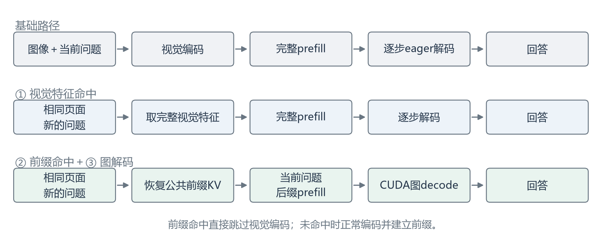
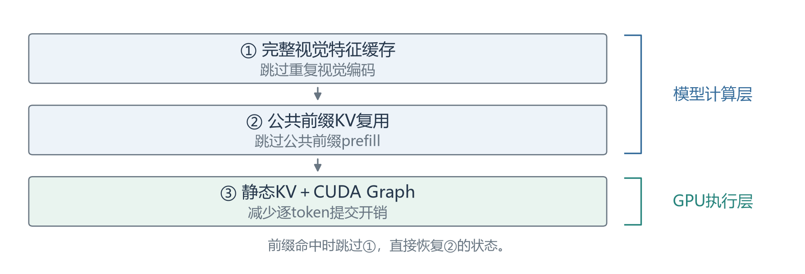
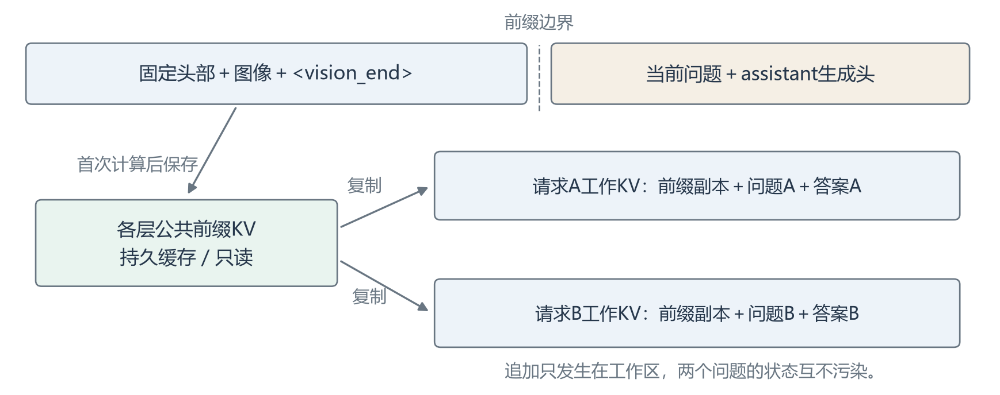
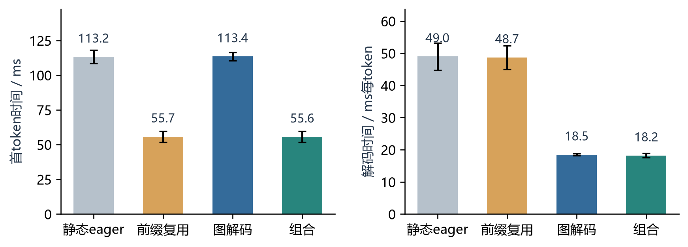
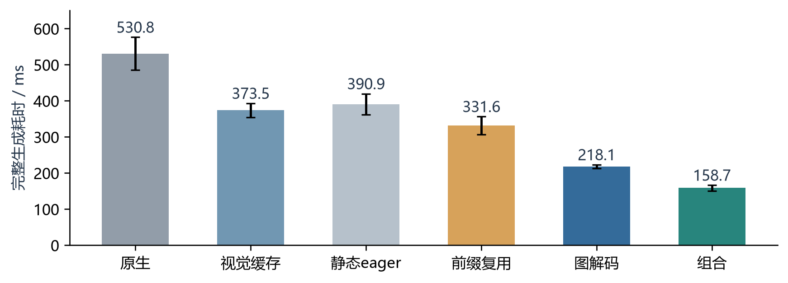
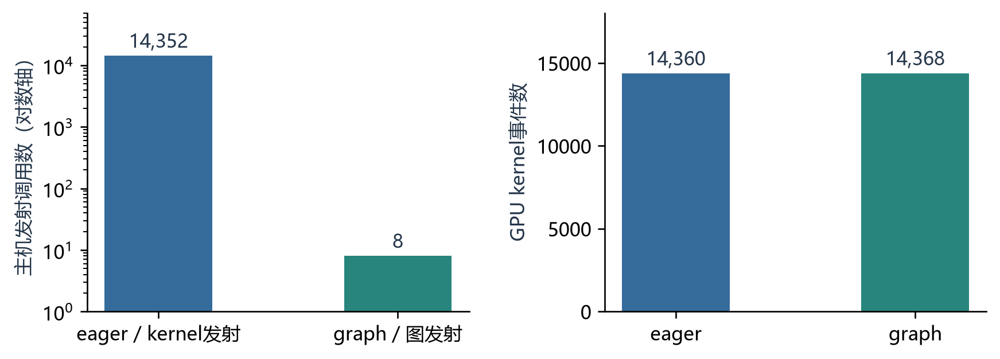

# 面向文档视觉问答的跨层推理优化<br>——视觉特征、公共前缀复用与CUDA Graph解码

## 1 问题描述

### 1.1 背景与问题

读取图片上的文字并进行提问，也就是文档视觉问答，是涉及cv的经典课题。在文档视觉问答中，用户向模型提供一张扫描文档，再询问日期、金额、机构名称等信息。同一页面通常对应多个不同问题。例如，用户先问“生效日期是什么”，再问“交付地点在哪里”，两次输入中的图片没有变化，但模型仍需要分别生成答案。本项目选择Qwen3-VL-2B-Instruct和DocVQA公开数据，在WSL2与8GB显存的笔记本GPU上研究这种多模态推理负载。


一次推理可以分为三个主要阶段：先用视觉编码器将图片转换为特征，再由语言模型处理图像和问题组成的输入，最后逐token生成答案。第二阶段通常称为prefill，即在生成第一个答案token之前，计算输入序列的表示和各层注意力状态；后续逐token生成则称为decode。

简单而言，同一张文档被反复询问时，会出现两类可以区分的开销：一类是相同图片和固定输入前缀被重复计算，另一类是生成每个token都要由CPU再次向GPU提交大量操作。前者涉及模型计算是否可以复用，后者涉及已有计算怎样在GPU上执行。本项目分别处理这两类开销，并用阶段计时、答案校验和实际CUDA trace检查优化是否作用于预期位置。

### 1.2 现有执行路径与优化空间

本项目的原生对照使用Transformers的generate接口，每个问题独立执行一次完整图文推理。接口内部已经利用KV cache保存本次请求的注意力状态，后续token不需要重新计算全部历史输入；但本次对照没有在不同请求间保留同页的视觉特征或公共前缀状态，也没有捕获单token解码图。因此，同页不同问题仍会重复处理图像和输入中的视觉段。

Qwen3-VL还通过DeepStack将多层视觉特征注入语言模型。这里不能只保存视觉编码器最后一层的输出，就认为后面的输入完全相同。对于前缀复用，也不能把第一个问题的全部KV直接交给第二个问题：问题内容一旦进入缓存，后续答案就会依赖前一个问题。优化必须先找出真正相同的状态，再明确这些状态的复用边界。


<!-- pagebreak -->

## 2 优化设计



针对上述问题，我们将优化分为三个部分：首先我们会复用完整视觉特征，跳过相同图片的重复编码；其次复用图像及固定头部的语言KV，只为当前问题计算后缀；最后使用静态KV和CUDA Graph执行逐token解码。前两项减少需要完成的计算，第三项改变这些计算的提交和执行方式。


### 2.1 优化层次与作用对象

表1 三项优化与两个执行层次

<!-- widths: 3.6, 4.2, 8.2 -->
| 优化项 | 对应层次 | 主要作用 |
| --- | --- | --- |
| 完整视觉特征缓存 | 软件算法／模型计算层 | 保存视觉主特征及3组DeepStack特征，省去重复视觉编码。 |
| 公共前缀KV复用 | 软件算法／模型计算层 | 保存问题之前的各层语言K/V，减少重复prefill。 |
| 静态KV与CUDA Graph | CPU–GPU协同／GPU执行层 | 固定工作缓冲，以图重放减少逐token的主机提交开销。 |




图2按优化对象画成三个逻辑层：第一层复用视觉表征，第二层复用语言前缀状态，第三层组织GPU解码执行。其中，前两层共同属于软件计算复用层。图中的层次也说明了三个模块的分工；其中的前缀命中时可以直接恢复语言状态，不必先读取视觉缓存，这两种持久表示也不要求同时驻留。

### 2.2 完整视觉特征缓存

视觉缓存指的是保存图片经过编码后的完整结果。当同一页面再次出现时，我们可以直接将这些特征交给语言模型。这一步避免重新运行视觉编码器，但语言模型仍要处理输入中的视觉token。因此，视觉缓存命中后，prefill仍有进一步优化空间。

这里的“完整特征”包括视觉主特征和3组DeepStack特征，其作用是保证后续语言计算所需的视觉输入一致。也就是说，同一页面的新问题只替换了文字部分，仍可以正常计算问题和答案。该项优化预期减少实际视觉编码次数，并缩短首token等待；这个优化不保存答案，也不直接减少后续decode步骤。

### 2.3 公共前缀KV复用


这一项继续复用视觉特征进入语言模型后产生的各层K/V状态。与仅保存视觉编码器输出相比，它能够进一步跳过公共视觉段的语言处理，让新请求更早进入当前问题的后缀计算。

我们把输入中第一个<vision_end>之后的位置作为边界。固定角色头部、图像token及其结束标记组成公共前缀，真实问题和assistant生成头位于其后。因为我们有因果注意力，所以前缀不能看到后面的问题，这就使得我们在模型、图片、前缀token和位置都相同时，前缀的各层K/V都可以跨问题复用。


例如，同一页面的两个问题可以共享已经计算好的页面状态，却不能共享“日期是什么”这句话的KV。持久缓存因此只保存边界前的状态；请求开始时将其复制到工作KV，再追加当前问题。这样既保留页面相关计算，又保证第二个问题不会继承第一个问题的上下文。

### 2.4 静态KV与CUDA Graph

在普通eager执行中，每生成一个token，Python、框架和CUDA运行时都要组织本步操作，再逐次提交给GPU。对于本项目B=1的小模型推理，操作提交之间的等待会占据明显时间。CUDA Graph可以将同一组GPU操作提前捕获，后续每步通过一次图发射执行，以减少CPU侧反复组织和提交的开销。

图重放依赖稳定的张量形状和地址，因此我们为各层预分配1024-token工作KV，并固定输入token、位置增量和mask生成所用缓冲。新请求可以通过原位复制更新内容，而不替换这些张量。图内只执行一个token的解码，EOS判断保留在图外，仍按模型真实输出或64-token上限停止。

静态KV负责提供稳定的存储与写入位置，CUDA Graph负责捕获和重放单步计算，两者共同构成第三项优化。

需要说明的是，三项优化作用于不同位置，我们不能把各自的下降百分比直接相加。视觉缓存影响视觉编码，前缀复用主要影响首token之前的prefill，CUDA图主要影响后续decode。因此我们的实验分别测量TTFT、完整生成耗时和每个后续token的解码时间，再检查组合方案的完整收益。


### 2.5 现有推理框架的对应机制

以vLLM为例，目前已有的推理框架已经提供以下功能：自动前缀缓存APC：把可复用的历史前缀KV保留下来，新请求命中后省去共享部分的prefill；同时通过CUDA图模式和运行时分发，在支持的批次与attention backend上选择图重放。这里的APC作用与本项目第二层相近，图执行管理与第三层相近，具体实现则涉及分块KV、批次形状及框架调度。

多模态输入还要区分CPU预处理结果与GPU视觉编码结果。命中图片预处理缓存，不一定意味着跳过视觉编码器；Qwen3-VL的视觉负载还必须包含DeepStack特征。框架对照同时记录实际encoder执行次数、前缀命中token和图重放，以检查每项机制的作用。

因此，对成熟框架的对照我们应同时回答两个问题：相同机制在框架中是否产生相同的阶段变化，以及框架启用这些机制后，整体请求成本与本原型相差多少。我们设计在与Transformers原生路径的开发对照说明阶段收益，4.7节进一步在独立评估集上比较完整请求路径和vLLM的实际缓存、图执行行为。


## 3 实现细节

### 3.1 完整视觉特征的组织

代码runtime.py中的_visual负责查找或生成视觉负载。未命中时调用原生get_image_features，保存一份主特征和3组DeepStack特征；命中时返回同样的完整结构。保存张量时使用独立clone，避免一个缓存切片继续持有整批临时张量的存储。


```python
result = (
    output.pooler_output[0].detach().clone(),
    tuple(t.detach().clone() for t in output.deepstack_features),
)
self.store.put(key, result, [result[0], *result[1]])
```

以上为当前实现的核心片段。主特征用于替换输入中的图像embedding，DeepStack特征在相应语言层注入。不同问题仍使用各自的文字输入，缓存中不保存问题答案。


本模型的完整视觉负载由4组宽度为2048的BF16特征组成，每个视觉token共占4×2048×2=16384字节，即16 KiB。以744个视觉token的页面为例，负载约为11.625 MiB。图片编码统一逐页执行，使缓存内容不随其他图片的拼接形状变化；所有对照均沿用相同的视觉处理配置。

### 3.2 前缀边界与跨问题隔离



prepare首先检查每条请求恰好具有一个视觉结束标记，并确认该标记后没有视觉token。缓存key同时绑定固定模型revision、处理配置、BF16与注意力后端、Transformers版本、图片像素身份、实际grid、精确前缀token以及mRoPE位置。仅图片名称相同不足以命中，图片或位置配置发生变化时必须重新计算。

前缀未命中时，_prefill先计算带DeepStack注入的公共部分，再克隆全部28层K/V，随后计算当前问题后缀。命中时，_restore将只读前缀复制到各层工作KV，并把各层游标恢复到前缀长度，再追加当前问题。每条请求开始时都会重置工作状态。

```python
if entry is not None:
    self._restore(entry, request.boundary)
else:
    self._language(request, end=request.boundary, visual=visual)
    entry = self._save(request.boundary)
output = self._language(request, start=request.boundary)
```

这段代码描述的是执行边界，实际实现还包含缓存写入、视觉负载释放和配额管理。我们可以将其分为三步理解：先取得公共状态，再在工作区恢复状态，最后只处理当前问题的后缀。当前B=1实现串行复用同一静态工作区，图中A/B对应不同时刻的请求状态。持久前缀与工作KV不共享可写存储，生成答案时更新的是工作区，而不是其他请求还会使用的缓存。


前缀状态也有明显的内存成本。本模型共有28个语言层、8个KV头，每头宽度128，BF16下每个输入token的各层K/V共占2×28×8×128×2=114688字节，即112 KiB，是完整视觉特征每token体积的7倍。因此，前缀缓存更适合反复询问的活跃页面，不能只根据热命中时间决定缓存规模。

### 3.3 工作KV、位置与图内操作

工作区采用Transformers的StaticCache，B=1、容量1024，初始化后保持各层key/value地址不变。prefill恢复正确的mRoPE状态，decode从设备端累计长度取得当前写入位置，再生成位置和attention mask。mask只允许访问已经填充的历史和本步位置，避免读取静态容量中的未使用区域。

```python
cursor = self.work.layers[0].cumulative_length
positions = (cursor + self.delta).view(1, 1, 1).expand(3, 1, 1)
visible = self.columns <= cursor
mask = torch.where(visible, 0.0, torch.finfo(torch.bfloat16).min).to(torch.bfloat16)
```

其中cursor和delta都是设备端状态。图内不将游标取回CPU，也不根据它进入Python分支。单步图继续执行语言层、lm_head和argmax，并原位更新token缓冲；图外读取真实输出token并判断EOS。这样可以在同一容量内处理不同长度的页面和问题，而不用每页重新捕获一张图。

建图时先执行完整prefill，保存工作KV和首token，再在独立stream上预热单步解码；捕获完成后恢复快照，使预热与捕获不会变成用户答案的一部分。图构建的全部费用单独记录，后续测量也检查图重放没有改变对应eager路径的token序列。

### 3.4 缓存预算与自动化记录

视觉特征与前缀KV使用同一个LRU配额，本轮固定为1536 MiB。同一页面写入前缀后，删除该页的视觉负载，避免同一页面的两种表示重复占用持久缓存。容量不足时驱逐旧条目，单条负载超过配额则不准入；模型、工作KV、图池和临时张量通过进程显存指标另行测量。

pilot.py负责真实请求执行、六路径对照、随机化区组、质量门槛和CUDA profiler采集；analyze_pilot.py从逐请求日志重新计算质量、阶段时间和底层调用数。manifest记录参数与测量源码SHA256，重跑时要求新的结果目录。


## 4 实验验证与结果分析

### 4.1 实验设置

我们的实验在AMD Ryzen 7 7735H、WSL2和RTX 4060 Laptop环境中进行，GPU显存为8188 MiB，WSL可见8个逻辑CPU。使用Python 3.12.3、PyTorch 2.14.0+cu130、Transformers 5.17.0，CPU计算线程固定为2。模型以BF16和SDPA执行，每张图片最多768个视觉token，greedy生成，最多64个新token，所有方案使用相同提示、EOS和图片配置。

实验数据来自固定版本的DocVQA镜像，保留真实文档图片、问题与参考答案。本次使用原开发划分的64页282问完成质量验证，再取其中前16个至少两问的页面，用每页第一条不同的真实问题预热，测量其余全部57问。页面来自预先固定的开发划分，不根据答案难度或加速结果筛选。


表2 六条执行路径的对照关系

<!-- widths: 3.5, 3.1, 3.2, 2.4, 3.8 -->
| 路径 | 视觉缓存 | 前缀KV | 解码方式 | 对照目的 |
| --- | --- | --- | --- | --- |
| NATIVE | 无 | 无 | 原生generate | 完整推理参照。 |
| VISUAL_HF | 有 | 无 | 原生generate | 已有视觉缓存的强基线。 |
| STATIC_EAGER | 有 | 无 | 静态KV／eager | 分离布局与生成循环的影响。 |
| PREFIX | 基础能力保留 | 有 | 静态KV／eager | 验证前缀复用。 |
| GRAPH | 有 | 无 | 静态KV／图重放 | 验证GPU执行优化。 |
| BOTH | 基础能力保留 | 有 | 静态KV／图重放 | 验证两项组合。 |

我们设计STATIC_EAGER、PREFIX、GRAPH和BOTH构成2×2消融。NATIVE与VISUAL_HF保留原生生成器，防止仅将优化版与较慢的新参考循环比较。各个缓存方案采用相同持久负载上限，PREFIX/BOTH保留视觉编码能力，页面建立前缀后使用互斥的前缀表示，不再额外保留同页视觉副本。


计时使用2901—2903三个种子，每组随机化六路径执行顺序，并对相同57问配对。共18个区组、1026条计时记录；另有六路径各282问，共1692条质量记录。每个计时区组均包含323次首token后的decode，六路径在全部171个“问题×种子”配对上输出token一致。

计时从GPU输入准备完成后开始，TTFT记录首个CPU可见token，完整生成时间覆盖真实EOS和答案解码，decode记录首token后的逐步循环。它们不含图像预处理、排队和网络，也不是纯GPU kernel耗时。下表使用三个区组的均值±样本标准差；区组处于同一进程，表3定位为开发验证，独立进程的框架评估见4.7节；开放环服务测量尚未执行。

### 4.2 计算复用对首token与生成时间的影响

表3 热页面生成阶段的计时结果

<!-- widths: 3.8, 4.0, 4.3, 3.9 -->
| 路径 | TTFT / ms | 完整生成 / ms | decode / ms每token |
| --- | --- | --- | --- |
| NATIVE | 267.6 ± 12.4 | 530.8 ± 45.5 | 46.45 ± 5.84 |
| VISUAL_HF | 119.9 ± 4.6 | 373.5 ± 19.7 | 44.76 ± 2.66 |
| STATIC_EAGER | 113.2 ± 4.8 | 390.9 ± 28.9 | 48.99 ± 4.24 |
| PREFIX | 55.7 ± 4.0 | 331.6 ± 24.9 | 48.68 ± 3.69 |
| GRAPH | 113.4 ± 3.1 | 218.1 ± 5.1 | 18.46 ± 0.36 |
| BOTH | 55.6 ± 4.1 | 158.7 ± 7.8 | 18.18 ± 0.66 |

视觉缓存将平均完整生成时间从530.8 ms降至373.5 ms，耗时减少约29.6%；TTFT从267.6 ms降至119.9 ms，说明重复视觉编码确实占据了首token之前的一部分工作。后续decode变化较小，与这项优化的作用位置一致。

在相同静态eager路径上加入前缀复用后，TTFT从113.2 ms降至55.7 ms，减少约50.8%；decode仍约为49 ms/token。简单而言，前缀缓存让模型更早开始回答，但不会省去每个答案token仍需执行的语言层。



完整282问扫描中，前缀方案发生64次miss、218次命中。miss时平均语言prefill为771.53 token，命中时为25.72 token。这两个均值分别来自对应请求集合，直接表明热命中路径跳过了视觉前缀的大部分语言处理；相同问题的时间收益则由上面的配对实验判断。

### 4.3 GPU解码与组合收益

CUDA图将静态eager的decode从48.99 ms/token降至18.46 ms/token，减少约62.3%，而TTFT保持在113 ms附近。这是因为图只覆盖单token解码，没有替换视觉编码和prefill。若仅查看完整生成时间，就难以区分这项收益究竟来自更快的首token，还是来自后续token。



组合方案平均生成时间为158.7 ms，相对VISUAL_HF的373.5 ms加速2.35倍，相对NATIVE的530.8 ms加速3.34倍。以相同问题集合计算，组合相对视觉缓存基线减少约57.5%的生成时间。这里的倍数来自同一测量范围中的“基线耗时÷优化耗时”，不能换成整个服务或其他页面分布的吞吐倍数。

三个配对区组中，前缀方案的TTFT节省分别为56.36、57.67、58.47 ms；图解码每token节省分别为28.50、27.98、35.11 ms。三组方向一致，第三组普通decode也有较明显波动，因此保留全部区组，以均值和标准差描述开发结果。

还可以看到，STATIC_EAGER的完整生成耗时为390.9 ms，高于VISUAL_HF的373.5 ms。预分配静态KV并不自动等于更快；它提供的是图捕获所需的稳定状态，真正的执行收益需要通过GRAPH对照确认。与原生强基线比较后，组合仍有收益，说明结论并非由一个较慢的新参照造成。

### 4.4 CUDA发射与GPU执行分析

为了检查底层机制，我们对相同八步真实模型decode采集CPU/CUDA profiler。eager记录14352次cudaLaunchKernel，图路径记录8次cudaGraphLaunch，平均每步由1794次kernel host发射变为一次图发射。



图内部仍执行模型kernels：eager的GPU kernel事件为14360个，graph为14368个，数量接近。因而不能把上述host调用变化理解为GPU计算量从14352次缩减到8次。优化减少的是主机提交与其间空隙，模型的主要计算仍然存在。

在这段profiler窗口中，kernel时间区间并集占首末kernel跨度的比例由19.5%变为95.5%，与图重放后执行更紧密的解释一致。不过，profiler会放大eager侧提交开销，窗口空隙也可能包含复制和同步；这个比例不是SM occupancy或全进程GPU利用率。实际加速仍采用前面未开启profiler的配对计时，trace用于解释执行方式。

### 4.5 显存、首次未命中与图构建成本

表4 缓存及启动成本

<!-- widths: 5.0, 5.2, 5.8 -->
| 检查对象 | 实测或计算结果 | 含义 |
| --- | --- | --- |
| 每token缓存体积 | 视觉16 KiB；语言KV 112 KiB | 前缀状态约为视觉特征的7倍。 |
| 热页面峰值allocated | VISUAL_HF 4.463 GiB；BOTH 5.443 GiB | 相同测量进程内比较。 |
| 完整开发扫描峰值 | PREFIX 5.715 GiB；BOTH 5.713 GiB | 包含更大的页面工作集。 |
| 持久负载最大值 | 1471.42 MiB，上限1536 MiB | 未超过固定缓存配额。 |
| 首次图构建 | 6.287 s | 包含prefill、预热、快照恢复和捕获。 |

这里的allocated是PyTorch分配量，不包含全部驱动和桌面开销；静态工作KV与图在六路径共同进程中常驻，表中原生路径也不是一个独立纯HF进程的最低显存。前缀复制的时间已经包含在TTFT中，并未把命中视为零成本操作。

热命中的50.8%首token降幅不能直接推广到首次访问。包含首次miss的282问单次扫描中，PREFIX的生成时间和为102.49 s，STATIC_EAGER为107.56 s，减少约4.7%；PREFIX的TTFT p95为307.1 ms，而VISUAL_HF为276.6 ms。前缀建立需要保存各层状态，且首次prefill被分为前缀和后缀两段，因此存在用额外状态和miss成本换取后续复用的取舍。这组单次扫描用于观察成本，不替代随机化配对计时。

图构建费用也需要摊销。按热页面STATIC_EAGER到GRAPH的平均每请求节省约172.8 ms估算，6.287 s约需37次相似请求抵消。这是基于本组请求长度的估算，短答案或低请求量场景需要重新计算，不能在冷启动总成本中直接省去建图费用。

### 4.6 质量与状态正确性验证

答案使用本地ANLS和EM评价。ANLS先作NFKC、大小写及空白归一化，再计算归一化编辑距离，多参考答案取最大分数；距离达到0.5时该候选记0。本项目固定质量门槛为相对原生ANLS下降不超过0.005，原始答案与token均保留。

表5 全部282问的开发质量结果

<!-- widths: 4.2, 3.5, 4.2, 4.1 -->
| 路径 | ANLS | 相对原生变化 | 与原生token一致 |
| --- | --- | --- | --- |
| NATIVE | 0.863630 | 0 | 282/282 |
| VISUAL_HF | 0.863630 | 0 | 282/282 |
| STATIC_EAGER | 0.867176 | +0.003546 | 280/282 |
| PREFIX | 0.866854 | +0.003224 | 278/282 |
| GRAPH | 0.867176 | +0.003546 | 280/282 |
| BOTH | 0.866854 | +0.003224 | 278/282 |

六路径均通过门槛。GRAPH与STATIC_EAGER的token为282/282一致，BOTH与PREFIX同样为282/282一致，说明图重放没有额外改变对应执行路径的答案。静态KV和前缀切分相对原生存在少量不同，反映BF16数值路径随执行形状变化；本次ANLS小幅增加不作为精度提升贡献。

此外，verify_runtime.py检查同页不同问题的前缀身份、异页miss、工作KV与持久前缀存储分离、回答追加不修改持久缓存、不同长度请求后的地址稳定，以及驱逐后重新miss。全部检查通过。

容量边界使用真实页面加合成长后缀，输入960个token，固定检查64个输出token，最终工作KV长度为1023，未超过1024容量，graph与eager输出一致。首个答案token由prefill预测，后续63步追加KV，因此此处的长度为960+63。合成长问题只用于正确性检查，不混入性能或质量集合。在运行时检查之外，我们进一步补充了当前前缀与图解码实现的形式化验证。

我们使用z3-solver 5.4.1.0，从当前runtime.py抽取_save、_restore、_decode和build_graph，并将Transformers 5.17.0的StaticLayer.update与reset放入符号张量模型。模型展开全部28层，检查前缀身份、因果依赖、克隆隔离、恢复游标、KV容量、mask可见范围、地址稳定、图数据流等价及捕获后的状态恢复，共9项性质。

九项安全查询全部为UNSAT，对应九项故障负控制全部为SAT；另有18项前提可满足性检查通过，排除矛盾前提造成的空证明。负控制能找到缓存键遗漏位置、共享存储、游标偏移、KV越界、mask开放未来槽位、旧位置重放和token地址改变等反例。36份SMT2、具体反例、源码快照及求解器版本随代码交付。

这些结论是在B=1、1024-token容量和最多64个输出token条件下，对状态与控制流程的条件化证明。哈希无碰撞、因果注意力、张量算子及CUDA Graph遵守接口语义作为前提；神经计算用确定性未解释函数表示。形式模型保证上述前提下的前缀隔离和图状态迁移，BF16数值及真实CUDA执行继续由GPU状态检查、282问输出对照与质量门槛验证。


### 4.7 与vLLM的独立评估对照

框架对照使用vLLM 0.32.0 Docker镜像。


新评估集为64页269问、47个源文档，与旧开发集和旧评估集的源文档、RGB均无交集，保留选中页面的全部真实问题。先在原282问上完成开发验收，再冻结配置、源码哈希和新评估顺序。每种实现使用4101—4103三个独立进程种子，并在每个种子内随机化实现顺序；共21次主启动、3次容量辅助启动、72个场景区组、9720条计时记录。

H0为HF原生，H1为HF加完整视觉缓存，P为本项目三项组合。vLLM的V00、V10、V01、V11依次对应APC与解码图模式的关关、开关、关开、开开，编译mode=3保持一致，图模式为NONE或FULL_DECODE_ONLY，使用InprocClient、B=1和1024-token上下文。本实验max_num_batched_tokens=1024时，框架派生的encoder缓存容量为1024 token；额外V11E仅将驻留容量扩为16384 token，单步encoder计算预算仍为1024，用来检查跨页面驻留容量的影响。

热场景用固定16页的首问预热，测量其余全部72问；会话场景清空页面缓存后测量全部269问，保留首次miss；每页一次场景清空缓存后测量64个首问。场景之间重置encoder、processor和prefix缓存。计时从驻留CPU图片和提示就绪开始，覆盖预处理、传输、首token和答案完成；文件读取、模型初始化和建图单列，不包含HTTP。它比表3的GPU输入就绪范围更完整，表6内的加速比均重新配对计算。

表6 独立评估的完整请求结果，三进程均值±标准差

<!-- widths: 1.5, 3.0, 3.0, 3.1, 3.1, 2.3 -->
| 实现 | 热TTFT/ms | 热请求/ms | 会话请求/ms | 每页一次/ms | ANLS |
| --- | --- | --- | --- | --- | --- |
| H0 | 314.0 ± 12.9 | 582.1 ± 26.5 | 536.7 ± 29.1 | 507.4 ± 28.1 | 0.916489 |
| H1 | 169.0 ± 7.7 | 436.0 ± 21.9 | 431.0 ± 20.9 | 504.9 ± 29.2 | 0.916489 |
| P | 121.6 ± 38.4 | 231.6 ± 41.6 | 278.4 ± 57.0 | 427.8 ± 31.3 | 0.916489 |
| V00 | 208.6 ± 4.2 | 316.8 ± 6.6 | 224.0 ± 5.6 | 315.2 ± 12.1 | 0.919587 |
| V10 | 89.7 ± 9.2 | 204.1 ± 25.5 | 186.3 ± 23.1 | 314.5 ± 17.6 | 0.919587 |
| V01 | 216.8 ± 9.9 | 306.4 ± 13.3 | 212.6 ± 7.3 | 298.7 ± 14.8 | 0.919587 |
| V11 | 86.3 ± 6.0 | 176.7 ± 10.7 | 153.4 ± 7.5 | 301.4 ± 13.6 | 0.919587 |
| V11E | 30.3 ± 1.3 | 120.9 ± 5.6 | 156.2 ± 7.0 | 294.0 ± 9.2 | 0.919587 |


热页面上，H1到P的完整请求由436.0 ms变为231.6 ms，耗时比为1.88；V00到V01由316.8 ms变为306.4 ms，反映在相同框架软件栈内改变图执行模式的效果。P、V11和V11E在热场景分别为231.6、176.7、120.9 ms，在含miss会话中分别为278.4、153.4、156.2 ms。本轮vLLM组合的平均请求耗时低于原型。P的热请求输入准备约为56.2 ms；框架另有CPU processor缓存，因此跨框架差异也包含输入处理路径，不能全部归为单一kernel。

三轮P热请求的输入准备范围为47.6—71.1 ms，较慢区组的额外时间主要出现在输入准备与首token之前。所有区组均保留在均值和标准差中；GPU采样用于描述设备状态，不据此将波动单独归因于某一种降频原因。

encoder计数说明容量也是比较的一部分：热场景72问中，V11平均执行36.7次视觉编码，V11E执行0.0次，P执行0.0次；V11与V11E的APC命中请求分别为72与72。图片预处理缓存、语言前缀缓存和完整视觉结果驻留分别影响不同工作，是否省去视觉编码需要看真实调用数。不同场景的问题成员和输出长度有差别，缓存收益以各场景内的同问题配置对照判断。

资源方面，vLLM固定KV池为1648 MiB，CPU processor缓存为0.125 GiB；P的1536 MiB为持久负载，另有112 MiB工作KV。框架KV池还供活跃请求使用，encoder与图池另计，所以不将两者称为等总缓存容量。P、V11、V11E在会话中的平均峰值allocated分别为5.743、5.783、6.028 GiB，均在同一8188 MiB设备上串行运行。三者初始化均值为8.05、27.14、28.28 s，首次请求可能触发的懒编译另外保留在热页面预热记录中。

所有配置在三个种子中均通过ANLS下降不超过0.005的门槛，最小逐种子变化为+0.000000。首token后八个CPU可见输出间隔的trace记录V00为1456次cudaLaunchKernel，V01为84次cudaLaunchKernel、7次cudaGraphLaunch，用于确认执行方式；框架可能提前执行下一步，该窗口不保证对应恰好八次GPU调用，也不能据此判断某一步回退。这些profiler时间不进入主表。原始答案、输出长度、EM、逐种子质量、配对t95区间、缓存调用与驱动采样均保存于框架实验目录。

### 4.8 AI辅助视觉缓存容量选择

第4.7节表明，视觉编码次数随缓存容量和访问顺序变化。这里补充一次离线选参实验，评估小语言模型能否根据开发记录选出适合16页交错回访的容量。固定策略沿用1024 token。AI策略在CPU上运行Qwen3-0.6B，读取开发集282问的V11计数、回访延迟和显存，以及开发集16页共11880个视觉token的工作集描述，从1024和16384 token两档作一次选择。AI输出限制为单个候选字母，每档都对应已有的一套vLLM实测记录。

模型选择1024 token。决策写入文件后，读取与开发集源文档互斥的热页面原始记录评估，配对3个独立进程，每组72问。两种策略落到同一档位，复用同一份记录。该档位的平均TTFT为86.3 ms，端到端耗时为176.7 ms，每组平均编码36.7次，ANLS为0.9088，PyTorch峰值allocated为5.78 GiB，满足6.75 GiB上限。AI选参在该轮未带来延迟收益。

作为事后参照，16384-token档位在同一热页面负载上平均TTFT为30.3 ms，端到端耗时为120.9 ms，平均视觉编码0次，ANLS为0.9088，峰值allocated为5.96 GiB。开发记录按页连续访问，218次回访中有0次视觉编码。热评估采用跨页交错回访，两种访问顺序的差异可能影响仅凭开发记录选参的效果。

AI单次前向耗时14.77 s，包含模型加载在内为16.96 s，计入调参阶段。该实验新执行的是AI决策及结果核对，性能数据来自第4.7节的GPU实测回放。两档结果说明模型在这组热页回访负载上选中了哪项现有配置，评估范围为一次决策、两档容量和一个访问场景。

## 5 适用范围与进一步验证

当前设计面向同页多问、B=1、短答案的文档视觉问答。在这种负载中，页面相关状态能够复用，而逐token主机提交又占据明显成本，因此前缀和CUDA图分别改善prefill与decode。方案依赖固定模型和处理配置、明确的前缀边界，以及工作容量内稳定的GPU缓冲。

页面只访问一次时，缓存没有后续复用机会；页面全局随机且工作集超过配额时，体积较大的前缀KV会更频繁驱逐。更长输入需要调整静态容量，较大batch或另一种模型也可能改变提交开销占比。本轮开发消融与独立框架评估共同支持本机目标负载下的机制分析；具体收益随访问方式、缓存容量和执行栈变化。

本次已完成源文档互斥的独立评估、三个独立进程种子、页面会话与每页一次对照。后续可进一步比较更大的页面工作集、全局随机访问、不同缓存预算、冷启动总成本和B=2对照，并补充到达率受控的开放环服务实验。第一轮已有的45轮主实验、18轮辅助实验与558问评估保留作历史材料，不与当前开发计时合并平均。

## 复现方法

本机复用stage_2/.venv、已有CUDA环境、固定模型权重和本地开发图片，不需重新编译CUDA或提供AI API密钥。从仓库根目录运行以下命令：

```bash
# 复算已有记录，生成开发报告、CSV及图
./stage_2/experiments/cross_layer_v2/run.sh report
# 在新目录执行状态检查、真实推理、计时和报告生成
./stage_2/experiments/cross_layer_v2/run.sh all \
  --output stage_2/experiments/cross_layer_v2/results/replay-new
```

代码位于stage_2/experiments/cross_layer_v2/；逐请求答案、计时、参数与源码哈希、图构建记录、两个CUDA trace位于其中的results/pilot/；状态检查位于results/runtime-check.json。报告复算覆盖1692条质量记录和1026条计时记录，并重新统计trace发射调用。入口拒绝覆盖已有重跑目录，前置条件见该目录README.md与stage_2/REPRODUCE.md。

框架对照代码与完整原始记录位于stage_2/experiments/framework_compare/。运行以下命令复核9720条计时记录、72个区组和两份解码trace，并重建框架图表：

```bash
./stage_2/experiments/framework_compare/run.sh report
python stage_2/tools/update_framework_design.py
```

从数据准备到真实执行的入口为同目录run.sh all，复用完成单元且拒绝覆盖未完成目录。全新重跑需使用独立工作副本，前置条件、固定镜像、配置哈希和逐步命令见该目录README.md；报告复算不需要启动GPU。

模型固定revision为89644892e4d85e24eaac8bacfd4f463576704203，DocVQA镜像固定revision为539088ef8a8ada01ac8e2e6d4e372586748a265e。完整环境和下载锁保存在stage_2/env/与configs/。

当前形式化验证入口为./stage_2/experiments/cross_layer_v2/run.sh formal，复用z3-solver==5.4.1.0，核对源码哈希并独立重放36份SMT2；不需要GPU、模型权重或网络。重新生成证明使用同一入口的--output 新目录，全部证明、反例和环境说明保存在formal/目录。

AI选参的可复现脚本为experiments/ai_cache_tuning/run.sh。README记录了Qwen3-0.6B权重revision与SHA256、CPU BF16、PyTorch和Transformers版本、提示词、候选动作与运行步骤。默认入口复算已保存的决策和原始GPU记录，新目录可重新运行本地模型。

## AI使用情况

1.用于完善实验步骤，使得实验对照更加完整，更具说服力

2.对实验的结果进行详细的总结和原因阐述，并对遇到的bug进行统计和分析

3.完成实验的测试评估代码的编写与检查

4.提出设计文档表述不正确的地方，并给予改善的建议，并汇总之前浏览的参考文献

5.辅助建立前缀KV与图解码的符号模型、故障负控制及自动复现脚本，求解结果由本地Z3实际计算。

6. 在第4.8节的离线选参实验中，实际运行固定版本Qwen3-0.6B生成一次容量决策，保存提示词、候选logits和决策耗时。

## 参考资料

1. Qwen团队，[Qwen3-VL-2B-Instruct模型说明](https://huggingface.co/Qwen/Qwen3-VL-2B-Instruct/blob/89644892e4d85e24eaac8bacfd4f463576704203/README.md)，固定revision如上；多模态结构及DeepStack说明。

2. Hugging Face，[How caching works](https://huggingface.co/docs/transformers/cache_explanation)，KV复用、因果注意力及动态／静态缓存说明；具体接口以本机固定版本源码为准。

3. PyTorch，[CUDA semantics: CUDA Graphs](https://docs.pytorch.org/docs/2.14/notes/cuda.html#cuda-graphs)，图捕获、稳定地址与重放约束。

4. Mathew、Karatzas、Jawahar，[DocVQA数据集](https://www.docvqa.org/datasets/docvqa)，文档图片问答任务与人工标注问题；原论文发表于WACV 2021。

5. vLLM，[Automatic Prefix Caching](https://docs.vllm.ai/en/v0.32.0/features/automatic_prefix_caching/)，APC的复用对象与prefill收益范围。

6. vLLM，[CUDA Graphs](https://docs.vllm.ai/en/v0.32.0/design/cuda_graphs/)，图模式、批次分发与后端兼容性。

7. vLLM，[Multimodal Inputs](https://docs.vllm.ai/en/v0.32.0/features/multimodal_inputs/)、[Engine Arguments](https://docs.vllm.ai/en/v0.32.0/cli/serve/)，多模态输入、DeepStack负载及配置接口。正式对照固定v0.32.0既有镜像，完整image ID与配置在实验协议中保存。
