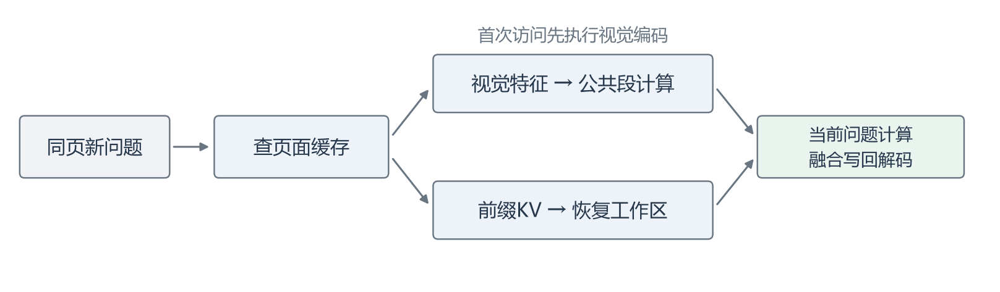
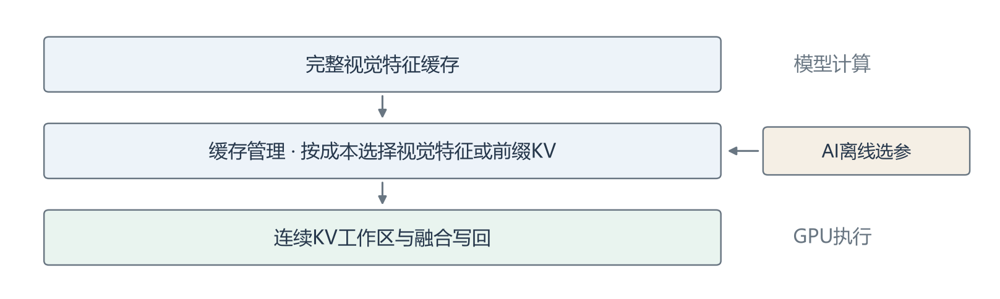
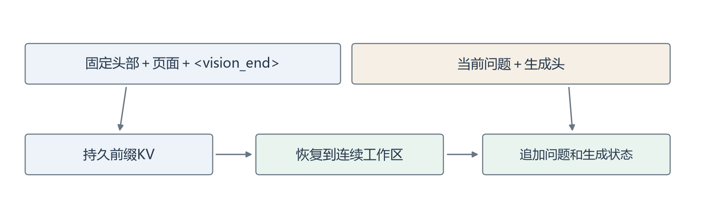
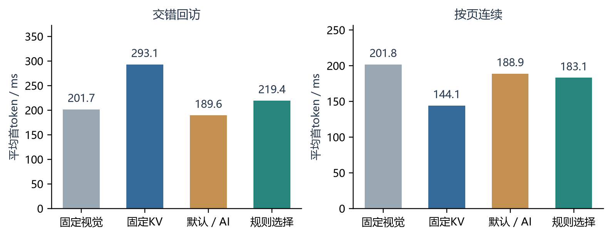
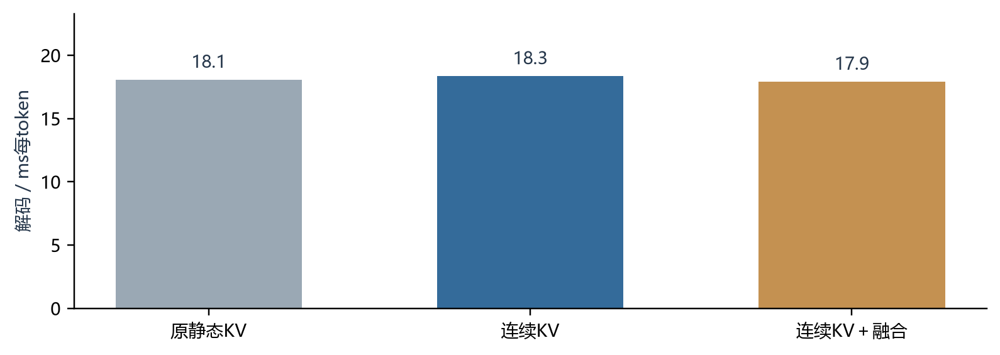
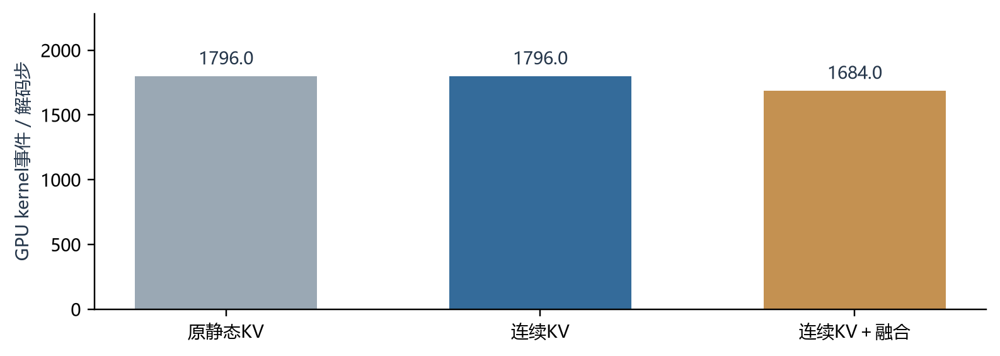
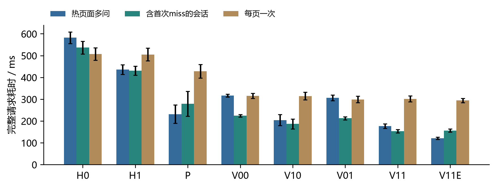

# 多模态推理优化——文档视觉问答按成本选择页面缓存与融合KV写回

## 1 问题描述

### 1.1 背景与问题

文档视觉问答是cv中的的经典课题，随着大模型的发展，如何更快更好的实现大模型的高效推理成了重要的研究课题。在文档视觉问答中，用户向模型提供一张扫描文档，再询问日期、金额、机构名称等信息，同一页面通常对应多个不同问题，例如，用户先问“生效日期是什么”，再问“交付地点在哪里”，两次输入中的图片没有变化，但模型需要分别生成答案，这里的优化点就可见一斑。本项目选择Qwen3-VL-2B-Instruct和DocVQA公开数据，在WSL2与8GB显存的笔记本GPU上研究这种多模态推理负载。

多模态大模型的一次推理可以分为三个主要阶段：先用视觉编码器将图片转换为特征，再由语言模型处理图像和问题组成的输入，最后逐token生成答案。第二阶段通常称为prefill，即在生成第一个答案token之前，计算输入序列的表示和各层注意力状态；后续逐token生成则称为decode。


简单而言，同一张文档被反复询问时，会出现两类可以区分的开销：一类是相同图片和固定输入前缀被重复计算，另一类是在生成每个token时，各层都要向GPU显存写回新的K、V。前者涉及怎样复用重复计算，后者涉及怎样组织设备端读写。本文通过阶段计时、答案检查和CUDA trace分别观察两处开销。

### 1.2 现有执行路径与优化空间

Transformers的generate接口在请求内利用KV cache，每次生成只追加当前token的注意力状态。对于同页不同问题，图像和固定前缀可以跨请求复用。保存完整视觉特征占用较小，再次访问时仍要执行公共段的prefill。语言前缀KV占用较大，命中后可以从问题后缀开始计算。缓存预算有限时，页面的回访间隔会影响两种表示的取舍。

Qwen3-VL使用DeepStack将多层视觉特征注入语言模型。缓存项需要保存主特征和对应的注入特征。语言侧的复用范围止于图像结束标记，随后把当前问题写入请求工作区。GPU侧为工作区提供固定地址，也可以将原先分发的逐层读写组织成更少的kernel。

<!-- pagebreak -->

## 2 优化设计



针对上述问题，我们将优化分为三个部分。第一部分保留完整视觉特征，减少同一页面的编码次数。第二部分引入AI离线选参，再根据回访间隔和缓存成本决定页面驻留视觉特征还是前缀KV。第三部分重组GPU上的工作KV，并融合每步解码的写回操作。

### 2.1 优化层次与作用对象

表1 三项优化的作用和执行层次

<!-- widths: 4.4, 3.1, 8.5 -->
| 优化项 | 对应层次 | 主要作用 |
| --- | --- | --- |
| 完整视觉特征缓存 | 软件／模型计算 | 保存视觉主特征和3组DeepStack特征，复用同页视觉编码。 |
| 成本缓存选择与AI离线选参 | 软件／缓存管理 | AI依据开发集实测选择成本参数，缓存按评分和配额决定是否保留前缀KV。 |
| 连续KV工作区与融合写回 | 硬件／GPU执行 | 连续恢复前缀，在同一Triton kernel中写K、写V和更新游标。 |



图2将AI的输出接入缓存管理层。选定的成本参数用于评估两种驻留表示，实际驻留的表示决定请求的prefill起点。当前问题和后续token都在GPU工作区内计算。

### 2.2 完整视觉特征缓存

对于同一张图片，视觉编码器输出的内容在不同问题之间相同。因此，页面初次访问时保存视觉主特征及3组DeepStack特征。命中时，主特征用于替换输入中的图像embedding，DeepStack特征仍按模型原定层注入。该路径跳过视觉编码，再根据当前问题完成语言模型的prefill。

本模型每个视觉token占16 KiB。以744个视觉token的页面为例，完整视觉特征约占11.63 MiB，适合在显存预算内覆盖较多页面。

### 2.3 按成本选择缓存表示与AI离线选参

页面首次访问先保留完整视觉特征。页面回访时，用两次请求的间隔估计未来可复用次数，再比较节省的prefill时间、生成KV副本的开销以及额外显存。评分达到阈值且KV子配额有空间时，将该页转换为前缀KV。下一次命中可以从问题后缀开始计算。其余页面继续用较小的视觉特征覆盖，持久缓存按最近最少使用顺序驱逐。

成本规则中的局部性系数决定回访间隔怎样折算为预期复用次数，KV子配额和评分阈值决定哪些页面值得保留语言前缀。这三个参数的不同取值构成候选配置。我们将默认成本、局部回访和宽配额三组策略放在相同的320 MiB预算下，通过开发集试运行获得两种访问顺序下的延迟、输出一致性与前缀命中情况。

AI是这项缓存优化的离线选参环节。Qwen3-0.6B根据上述实测指标，从三组参数中选择一组。选参目标是两种访问顺序等权时的平均首token延迟，同时以输出一致性和固定缓存预算约束候选范围。选择结果在评估前冻结。上线处理每次回访时，由缓存管理器使用这组参数计算页面的收益与显存成本，决定是否将视觉特征转换为前缀KV。

### 2.4 连续KV工作区与融合写回

原本的静态实现为每一层单独分配K、V。一次前缀命中需要把持久缓存中的K、V逐层复制到请求工作区，并逐层更新游标。游标记录下一次写入的位置。完成当前问题的prefill后，每处理一个生成token，各层还要计算写入位置、推进游标，再分别写K和V。前一部分计入首token延迟，后一部分随解码步数重复发生。

本优化将28层K、V放入一个连续的GPU工作区，并为各层建立固定视图。工作区按最大长度预分配，后续请求沿用同一组地址。持久前缀按页面的实际长度另存为紧凑快照。前缀命中时，一个kernel遍历整个工作区，在搬运有效K、V的同时清零旧请求留下的尾部，再批量设置各层游标。当前问题由前缀结束后的槽位接着写入，页面快照可以继续供后续问题复用。

对单token解码而言，K、V的写入位置都由旧游标决定。我们用一个Triton kernel完成本层地址计算、两次写入和游标推进。这样，每层每步的KV更新由一次kernel调用完成。实验中的三种GPU路径均以CUDA Graph提交单步解码，分别比较连续工作区对前缀恢复的影响，以及融合写回对解码的影响。

### 2.5 现有推理框架的对应机制

vLLM的自动前缀缓存按块复用公共语言KV，运行时根据输入形状和注意力后端分发CUDA Graph。它还分别管理图片预处理和视觉编码结果。对Qwen3-VL，视觉特征包含后续语言层所需的DeepStack输入，因此框架是否跳过视觉编码，可以从实际发生的encoder调用数判断。

本设计的缓存选择发生在页面级，针对的是小显存下两种复用表示的取舍。本文在相同Qwen3-VL运行时消融这一策略，并保留第4.8节的vLLM独立测量，用于比较公共前缀、视觉驻留和解码执行在成熟框架中的量级。

## 3 实现细节

### 3.1 完整视觉特征的组织

实验入口位于experiments/adaptive_kv/。engine.py在页面未命中时调用原生get_image_features，将主特征和3组DeepStack输出复制到缓存中。缓存以页面前缀身份为键，每页持有一种表示。图像编码统一逐页执行，各路径沿用相同的处理配置和语言模型。

### 3.2 前缀边界与成本计算



prepare检查请求中的图像结束标记，并以该标记之后的位置划分prefill。缓存键由模型版本、处理配置、图像像素、图像网格、公共段token和mRoPE位置共同确定。前缀命中时，将持久KV恢复到工作区，再把当前问题和生成头写入工作区。恢复及追加均作用于工作地址，持久前缀作为只读输入。

设两次访问的请求间隔为g，局部性系数为s，估计复用次数为s / max(1, g)。以T表示热命中时前缀KV相对视觉缓存节省的TTFT，C表示保存前缀的额外代价，ΔM表示前缀KV相对视觉特征多占的MiB。评分为[(s / max(1, g)) × T − C] / ΔM。该值衡量每增加1 MiB驻留量所换取的预期首token时间。

T和C在开发集上通过8页的配对计时校准。视觉缓存命中和前缀缓存命中的TTFT之差取中位数，T为93.15 ms。同页首次访问的两种保存路径之差取中位数，C为2.40 ms。另设KV子配额，给视觉特征保留空间。所有策略继续受320 MiB总负载限制。

### 3.3 离线选参与运行时配置

select_ai.py对每组候选的TTFT均值和P95按两种访问顺序分别等权汇总，并附上各场景的前缀命中次数和输出token一致性。这些指标作为提示词输入。Qwen3-0.6B在CPU上以BF16运行一次，比较三个候选字母对应的logit，选取最高者。

程序将候选字母映射回表2的参数组，并保存提示词、候选logits、选择结果及开发记录哈希。bench.py在独立评估开始前核对开发记录和协议哈希，按选定配置初始化局部性系数、KV子配额和评分阈值。逐请求的缓存决策在engine.py中按同一成本公式执行。

### 3.4 连续工作区与Triton写回

fused.py中，工作区按[层, K或V, KV头, 槽位, 每头维度]排列，本实验的形状为[28, 2, 8, 1024, 128]。K、V采用BF16，共占112 MiB。初始化时，StaticCache中的每个StaticLayer将本层的K、V绑定到工作区的两个固定切片。各层游标指向同一个游标张量中的对应元素。注意力层继续通过原有接口读取本层的K、V。

设公共前缀长度为L。保存快照时，`Arena.save`从每组K、V中取前L个槽位，复制到独立的连续张量。命中时，`_restore`按块遍历目标工作区，把线性位置换算为对应层、K或V、KV头和槽位。槽位小于L时从快照取值，其余槽位写零。随后将所有层的游标设为L。例如，恢复750个token后，有效槽位为0到749，当前问题从槽位750开始追加。

解码时，`_append`为每层启动一个Triton program，先读出旧游标p，再由各并行元素处理对应的KV头和头内维度。源地址按实际输入stride计算，K和V分别写入本层的槽位p，游标更新为p+1。边界掩码把写回限制在0到1023号槽位内，达到容量上限时保留游标原值。prefill中的多token更新沿用Transformers的原有算子。

CUDA Graph捕获的是单token解码步骤。每次重放使用同一组缓冲地址，读取其中的当前token和游标，根据游标与mRoPE偏移生成位置，并通过注意力掩码开放截至槽位p的范围。下一token写回同一个输入缓冲，供下次重放使用。EOS判断在图外执行。

### 3.5 自动化与记录

bench.py冻结数据顺序、候选参数与代码哈希，写出逐请求的TTFT、生成时间、输出token、缓存占用、命中和编码次数。自动化入口按开发测量、离线选参和独立评估的顺序运行。analyze.py核对请求顺序、质量和预算，并从原始CUDA trace重新统计kernel数。运行过程中固定配置和原始数据分别保存，便于重跑和复算。

## 4 实验验证与结果分析

### 4.1 实验设置

实验使用WSL2、RTX 4060 Laptop GPU（8 GiB）、Qwen3-VL-2B-Instruct、BF16，固定B=1。开发和独立评估各选取16页44道DocVQA真实问题，分别来自16个源文档，两个集合的源文档和图片像素互斥。每个集合有4页各5问及12页各2问。交错回访中，四个高频页之间夹入其他页面，低频页稍后返回。按页连续场景使用同一批问题，顺序改为逐页问完再切换。

表2 缓存策略与候选参数

<!-- widths: 2.8, 1.3, 2.6, 2.5, 6.8 -->
| 策略 | s | KV子配额 | 评分阈值 | 存储规则 |
| --- | --- | --- | --- | --- |
| 固定视觉 | — | — | — | 驻留完整视觉特征 |
| 固定KV | — | — | — | 初次访问写入前缀KV |
| 默认成本 | 6 | 55% | 0.65 | 按评分和配额更新表示 |
| 局部回访 | 14 | 55% | 0.65 | 按评分和配额更新表示 |
| 宽配额 | 20 | 80% | 0.60 | 按评分和配额更新表示 |

各路径每次从空页面缓存开始，首访问纳入计时。TTFT从GPU输入就绪计到第一个token，完整生成进一步包含后续解码及文本转换。模型加载和输入准备在计时窗口外完成，图构建耗时单独记录。开发集执行一个随机区组，评估集执行两个配对区组，同一区组随机排列场景和配置。软件消融使用相同融合硬件路径，GPU消融统一用热前缀命中。

### 4.2 缓存选择对首token与生成时间的影响

表3 独立评估的请求延迟与复用情况

<!-- widths: 2.5, 3.4, 3.0, 3.0, 4.1 -->
| 访问顺序 | 策略 | TTFT / ms | 生成 / ms | 编码／KV命中 |
| --- | --- | --- | --- | --- |
| 交错 | 固定视觉 | 201.7 | 295.1 | 16／0 |
| 交错 | 固定KV | 293.1 | 386.6 | 44／0 |
| 交错 | 默认成本（AI） | 189.6 | 283.1 | 16／6 |
| 交错 | 宽配额（规则） | 219.4 | 312.8 | 28／9 |
| 连续 | 固定视觉 | 201.8 | 295.2 | 16／0 |
| 连续 | 固定KV | 144.1 | 237.2 | 16／28 |
| 连续 | 默认成本（AI） | 188.9 | 282.3 | 16／6 |
| 连续 | 宽配额（规则） | 183.1 | 276.3 | 16／9 |

编码次数和KV命中次数以每条44问访问序列计。固定KV在交错场景平均编码44次，AI选出的成本策略编码16次。相对固定KV，所选成本策略在交错回访的平均TTFT下降35.3%，在按页连续时上升31.0%。交错场景和固定视觉相比，所选策略的平均TTFT下降6.0%，两者同为16次视觉编码。两场景使用相同的问题成员，差异体现了访问次序对驻留和复用的影响。



交错场景中，所选策略的TTFT P95为303.3 ms，固定KV和固定视觉分别为305.5和301.0 ms。平均值和尾延迟一起描述开始新页面、视觉命中和前缀命中混合后的成本。

### 4.3 AI离线选参的效果

按第3.3节的流程，分别用Qwen3-0.6B和直接排序选择成本参数。两场景TTFT均值等权汇总后，候选分别为默认成本206.93 ms、局部回访205.74 ms、宽配额201.01 ms。冻结选择结果后，在独立评估集中测量各配置，结果见表3。

模型选择了默认成本组。独立评估中的固定默认对照使用这组配置。按开发集TTFT直接排序选中宽配额。独立评估按两种访问顺序等权，排序策略和AI策略的平均TTFT分别为201.2 ms和189.2 ms，AI选择的配置下降6.0%。按页连续时，AI配置的平均TTFT为188.9 ms，排序配置为183.1 ms。交错场景两个配对区组中，宽配额的TTFT分别为219.7、219.1 ms，AI所选策略分别为189.9、189.3 ms。AI前向耗时12.96 s，含加载14.44 s，计入离线校准。

### 4.4 GPU工作区和写回融合的消融

选择评估集前三个不同页的请求，每条先建立热前缀，再固定执行八个后续解码步。八个配对区组内随机排列三个GPU实现，共72条计时记录。三条路径使用同样的模型、输入和CUDA Graph解码方式。连续KV组替换恢复布局，融合组在同一布局上进一步替换单token写回kernel。

表4 热前缀条件下的GPU路径对照，三条路径各24条计时

<!-- widths: 3.3, 2.7, 3.6, 2.9, 3.5 -->
| GPU路径 | TTFT / ms | 解码 / ms每token | 生成 / ms | kernel / 步 |
| --- | --- | --- | --- | --- |
| 原静态KV | 53.01 | 18.05 | 197.48 | 1796 |
| 连续KV | 48.28 | 18.33 | 194.97 | 1796 |
| 连续KV＋融合 | 48.89 | 17.89 | 192.10 | 1684 |



原静态KV、连续KV和融合写回的单token解码时间分别为18.05、18.33和17.89 ms。相对原静态实现，组合路径的解码耗时下降0.9%，在八个配对区组中的7个更短。相对连续KV组，写回融合使解码耗时下降2.4%。热前缀TTFT下降7.8%，该阶段的计时包含连续前缀恢复和游标更新。

### 4.5 CUDA发射与GPU执行分析



另取同一条热请求记录两次图重放。原静态和融合路径的主机图提交分别为2和2次，每步GPU kernel事件由1796降为1684，数量下降6.2%。原路径每步包含56个index_copy事件，融合路径每步包含28个写回kernel。执行迹线将变化定位到静态KV更新，计时仍覆盖注意力和模型其余算子。

### 4.6 显存与执行成本

单个语言前缀token的28层K/V占112 KiB。以附有图像和固定头部的750-token前缀为例，紧凑快照约82.03 MiB。实际视觉缓存随每页视觉token数变化，实际KV负载还取决于固定头部长度。总持久缓存预算固定为320 MiB，表5列出每种策略在两场景内的最大驻留量。

评估进程观察到的PyTorch峰值allocated为4.70 GiB。该进程为机制对照共存三张图和两套工作区。原静态、连续和融合路径依次构建，记录分别为3.59、0.49和0.56 s，包含各自预热和捕获。图按顺序构建，首条路径的记录包含进程首次相关初始化。

### 4.7 输出质量与状态正确性

表5 独立评估的输出一致性与峰值缓存负载

<!-- widths: 3.2, 2.9, 2.9, 3.6, 3.4 -->
| 策略 | 交错token一致 | 连续token一致 | 交错／连续ANLS | 峰值负载 / MiB |
| --- | --- | --- | --- | --- |
| 固定视觉 | 88/88 | 88/88 | 0.8712／0.8712 | 176.8 |
| 固定KV | 88/88 | 88/88 | 0.8712／0.8712 | 266.0 |
| 默认成本（AI） | 88/88 | 88/88 | 0.8712／0.8712 | 316.6 |
| 宽配额（规则） | 88/88 | 88/88 | 0.8712／0.8712 | 317.5 |

表5各策略在每个场景的88条请求中，输出token均与固定视觉路径逐条一致。硬件消融的24组配对输出在三条路径上均一致。额外GPU检查覆盖旧尾部清零、持久前缀保持、工作区地址稳定、非连续输入stride，以及最后有效槽位和满容量保护。

已有Z3模型对早一轮前缀与图解码运行时的9项状态性质返回UNSAT，九项故障负控制返回SAT，并保存36份SMT2。该模型给出了前缀身份、读写隔离、位置与容量的验证条件。本轮缓存驻留、连续恢复和Triton写回使用上面的逐请求、张量与设备边界检查。

### 4.8 与vLLM的独立评估对照

早一轮框架对照使用vLLM 0.32.0 Docker镜像，原型P采用当时固定前缀KV与图解码路径。表6沿用该次完整请求的口径，作为框架机制参照。


该轮评估集为64页269问、47个源文档，与旧开发集和旧评估集的源文档、RGB均无交集，保留选中页面的全部真实问题。先在原282问上完成开发验收，再冻结配置、源码哈希和新评估顺序。每种实现使用4101—4103三个独立进程种子，并在每个种子内随机化实现顺序；共21次主启动、3次容量辅助启动、72个场景区组、9720条计时记录。

H0为HF原生，H1为HF加完整视觉缓存，P为早一轮的跨层组合。vLLM的V00、V10、V01、V11依次对应APC与解码图模式的关关、开关、关开、开开，编译mode=3保持一致，图模式为NONE或FULL_DECODE_ONLY，使用InprocClient、B=1和1024-token上下文。本实验max_num_batched_tokens=1024时，框架派生的encoder缓存容量为1024 token；额外V11E仅将驻留容量扩为16384 token，单步encoder计算预算仍为1024，用来检查跨页面驻留容量的影响。

热场景用固定16页的首问预热，测量其余全部72问；会话场景清空页面缓存后测量全部269问，保留首次miss；每页一次场景清空缓存后测量64个首问。场景之间重置encoder、processor和prefix缓存。计时从驻留CPU图片和提示就绪开始，覆盖预处理、传输、首token和答案完成；文件读取、模型初始化和建图单列，不包含HTTP。这一计时包含输入准备，表6内的加速比按该轮的同题记录配对计算。

表6 独立评估的完整请求结果，三进程均值±标准差

<!-- widths: 1.5, 3.0, 3.0, 3.1, 3.1, 2.3 -->
| 实现 | 热TTFT/ms | 热请求/ms | 会话请求/ms | 每页一次/ms | ANLS |
| --- | --- | --- | --- | --- | --- |
| H0 | 314.0 ± 12.9 | 582.1 ± 26.5 | 536.7 ± 29.1 | 507.4 ± 28.1 | 0.916489 |
| H1 | 169.0 ± 7.7 | 436.0 ± 21.9 | 431.0 ± 20.9 | 504.9 ± 29.2 | 0.916489 |
| P | 121.6 ± 38.4 | 231.6 ± 41.6 | 278.4 ± 57.0 | 427.8 ± 31.3 | 0.916489 |
| V00 | 208.6 ± 4.2 | 316.8 ± 6.6 | 224.0 ± 5.6 | 315.2 ± 12.1 | 0.919587 |
| V10 | 89.7 ± 9.2 | 204.1 ± 25.5 | 186.3 ± 23.1 | 314.5 ± 17.6 | 0.919587 |
| V01 | 216.8 ± 9.9 | 306.4 ± 13.3 | 212.6 ± 7.3 | 298.7 ± 14.8 | 0.919587 |
| V11 | 86.3 ± 6.0 | 176.7 ± 10.7 | 153.4 ± 7.5 | 301.4 ± 13.6 | 0.919587 |
| V11E | 30.3 ± 1.3 | 120.9 ± 5.6 | 156.2 ± 7.0 | 294.0 ± 9.2 | 0.919587 |



热页面上，H1到P的完整请求由436.0 ms变为231.6 ms，耗时比为1.88；V00到V01由316.8 ms变为306.4 ms，反映在相同框架软件栈内改变图执行模式的效果。P、V11和V11E在热场景分别为231.6、176.7、120.9 ms，在含miss会话中分别为278.4、153.4、156.2 ms。本轮vLLM组合的平均请求耗时低于原型。P的热请求输入准备约为56.2 ms；框架还复用了CPU processor结果，跨框架耗时包括各自的输入准备路径。

三轮P热请求的输入准备范围为47.6—71.1 ms，较慢区组的额外时间主要出现在输入准备与首token之前。所有区组均用于计算均值和标准差。

encoder计数说明容量也是比较的一部分：热场景72问中，V11平均执行36.7次视觉编码，V11E执行0.0次，P执行0.0次；V11与V11E的APC命中请求分别为72与72。图片预处理缓存、语言前缀缓存和完整视觉结果驻留分别影响不同工作，是否省去视觉编码需要看真实调用数。不同场景的问题成员和输出长度有差别，缓存收益以各场景内的同问题配置对照判断。

资源方面，vLLM固定KV池为1648 MiB，CPU processor缓存为0.125 GiB；P的1536 MiB为持久负载，另有112 MiB工作KV。框架KV池还供活跃请求使用，encoder与图池单独分配。P、V11、V11E在会话中的平均峰值allocated分别为5.743、5.783、6.028 GiB，均在同一8188 MiB设备上串行运行。三者初始化均值为8.05、27.14、28.28 s，首次请求可能触发的懒编译另外保留在热页面预热记录中。

所有配置在三个种子中均通过ANLS下降不超过0.005的门槛，最小逐种子变化为+0.000000。首token后八个CPU可见输出间隔的trace记录V00为1456次cudaLaunchKernel，V01为84次cudaLaunchKernel、7次cudaGraphLaunch，用于确认执行方式；这些计数来自单列的CPU可见输出诊断窗口。原始答案、输出长度、EM、逐种子质量、配对t95区间、缓存调用与驱动采样均保存于框架实验目录。

## 5 适用范围与进一步验证

本次实验面向同页多问、B=1和短答案的文档视觉问答。成本缓存的配置可由AI根据开发样本离线选择，并在独立负载上验证。在320 MiB持久缓存预算下，页面的回访顺序影响应当保留的表示。交错回访和按页连续的对照给出了同一套策略在不同访问次序下的延迟和命中变化。连续KV与写回融合则在固定解码步数时改变GPU的执行粒度，作用由CUDA trace和配对计时共同验证。

本原型针对Qwen3-VL的固定处理配置和1024-token工作容量。进一步测试可以沿显存预算、实际页面流量和batch大小展开，并在同一计时口径下将新策略纳入vLLM对照。

## 复现方法

在Linux或WSL2中复用stage_2/.venv。GPU重跑需要CUDA环境、固定Qwen3-VL与DocVQA图片，以及本地Qwen3-0.6B。环境清单、权重SHA256、Triton版本、输入顺序与逐步命令在experiments/adaptive_kv/README.md及results/main/保存。

```bash
./stage_2/experiments/adaptive_kv/run.sh report
./stage_2/experiments/adaptive_kv/run.sh all stage_2/experiments/adaptive_kv/results/replay-new
```

report从冻结的数据重算表3至表5所用统计和trace计数。all依次执行开发GPU测试、CPU离线选参、独立GPU测试及统计。逐请求原始输出、校准样本、GPU trace、参数选择和结果摘要均随代码保留。

表6的独立框架对照由experiments/framework_compare/run.sh report复算。Z3证明由experiments/cross_layer_v2/run.sh formal重放，固定z3-solver 5.4.1.0。框架重跑另需原记录指定的vLLM Docker镜像，两项证据保留对应代码与环境。

## AI使用情况

1. 辅助检查实验计划的可行性，并补充缓存命中、回访顺序、GPU写回和答案一致性的对照。

2. 协助检查WSL、GPU、Python依赖和本地模型权重，复用可运行的环境。

3. 辅助编写逐请求计时、Triton消融、质量检查和自动化复算代码。

4. 校读手写设计文档，复查实验口径、图表和结论之间的对应关系。

5. Qwen3-0.6B参与第2.3节的缓存优化设计，负责离线选择成本参数。第4.3节给出独立评估结果。

## 参考资料

1. Qwen团队，[Qwen3-VL-2B-Instruct模型说明](https://huggingface.co/Qwen/Qwen3-VL-2B-Instruct/blob/89644892e4d85e24eaac8bacfd4f463576704203/README.md)，固定revision如上；多模态结构及DeepStack说明。

2. Hugging Face，[How caching works](https://huggingface.co/docs/transformers/cache_explanation)，KV复用、因果注意力及动态／静态缓存说明；具体接口以本机固定版本源码为准。

3. PyTorch，[CUDA semantics: CUDA Graphs](https://docs.pytorch.org/docs/2.14/notes/cuda.html#cuda-graphs)，图捕获、稳定地址与重放约束。

4. Mathew、Karatzas、Jawahar，[DocVQA数据集](https://www.docvqa.org/datasets/docvqa)，文档图片问答任务与人工标注问题；原论文发表于WACV 2021。

5. vLLM，[Automatic Prefix Caching](https://docs.vllm.ai/en/v0.32.0/features/automatic_prefix_caching/)，APC的复用对象与prefill收益范围。

6. vLLM，[CUDA Graphs](https://docs.vllm.ai/en/v0.32.0/design/cuda_graphs/)，图模式、批次分发与后端兼容性。

7. vLLM，[Multimodal Inputs](https://docs.vllm.ai/en/v0.32.0/features/multimodal_inputs/)、[Engine Arguments](https://docs.vllm.ai/en/v0.32.0/cli/serve/)，多模态输入、DeepStack负载及配置接口。正式对照固定v0.32.0既有镜像，完整image ID与配置在实验协议中保存。

8. Triton，[triton.language.load](https://triton-lang.org/main/python-api/generated/triton.language.load.html)、[triton.language.store](https://triton-lang.org/main/python-api/generated/triton.language.store.html)，索引、掩码及设备端写入语义。
