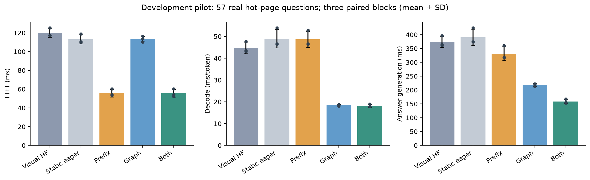

# 第二轮开发验证：多模态前缀复用与 CUDA Graph 解码

状态：**开发验证已完成，两项新方向进入正式实验候选。尚未重跑第二轮独立评估与开放环实验。** 第一轮 45 轮主实验、18 轮辅助实验、558 问评估、报告与提交包完整保留。

## 1. 经验与本轮选择

第一轮视觉特征缓存有直接收益；图像亲和调度的独立增益区间跨零，且存在尾延迟取舍；价值替换的预算实验吞吐差绝对值最大约 0.59%，不足以支持其作为核心贡献。继续更换调度权重或替换评分函数，难以增加有力的跨层证据。

第二轮保留同一文档多问的真实多模态任务和已有视觉缓存，采用两个方向：

| 方向 | 对应层次 | 实际减少的工作 | 独立证据 |
| --- | --- | --- | --- |
| A：多模态公共前缀 KV 复用 | 软件算法／模型计算图 | 重复图像前缀的语言 prefill | 命中后只计算问题后缀，TTFT 下降 |
| B：静态 KV + CUDA Graph 解码 | CPU–GPU 协同／GPU 执行 | 逐 token 的主机 CUDA 提交 | 真实 CUDA trace 中 runtime 发射调用减少，decode 时间下降 |

视觉特征缓存和前缀缓存属于同一个计算复用层，不能将二者计为“两层”。作业中的两个不同层次由 **A 的模型计算复用与 B 的 GPU 执行优化**共同满足；不需要更换物理硬件。B 并非单纯切换到 GPU，而是改变已有 GPU 的命令提交和静态显存执行方式。

建议题目：**面向文档视觉问答的跨层推理优化——多模态前缀状态复用与 CUDA Graph 解码。** 详细方案见[经验总结与第二轮优化](../../plan/经验总结与第二轮优化.md)。

## 2. 测量对象与控制条件

- 设备：WSL2 上的 RTX 4060 Laptop 8GB，复用现有 PyTorch 2.14.0+cu130 / Transformers 5.17.0；本轮没有安装或升级基础环境。
- 模型：固定 revision 的 Qwen3-VL-2B-Instruct；BF16/SDPA、单请求 B=1、每图最多 768 视觉 token、greedy、相同提示、EOS 与 64 新 token 上限。
- 只读取第一轮的 **64 页 282 问开发集**。第二轮没有读取原 558 问评估输出，也没有用新独立评估集选参数。
- 缓存方案共用 **1536 MiB 持久负载上限**，同页视觉特征与前缀 KV 使用互斥表示。模型、静态工作 KV、图池和临时张量另计，并测量总 allocated；这个预算不同于第一轮，不能直接与第一轮的吞吐横比。
- 六路径：NATIVE 原生推理；VISUAL_HF 原生生成器加完整视觉缓存；STATIC_EAGER 视觉缓存加静态 KV/普通逐步执行；PREFIX 加 A；GRAPH 加 B；BOTH 加 A+B。后三者相对于 STATIC_EAGER 构成 2×2 消融。
- 热页面计时取开发划分中前 16 个至少两问的页面，用每页第一条**不同的真实问题**预热，测其余全部 57 问。三个种子 2901–2903 随机化六路径顺序，并在相同问题上配对；总计 18 区组、1026 条计时记录。
- 指标从已准备好 GPU 输入开始，TTFT 是首个 CPU 可见 token，完整生成包含真实 EOS 与答案解码；decode 是首 token 后的实际逐步循环时间，含公共同步与 EOS 检查。**这些不是含排队、图像预处理和网络的服务端到端延迟，也不是纯 GPU kernel 时长。**
- 原生路径保留 DynamicCache；所有路径在同一个原型进程中执行，静态工作 KV 与捕获图也常驻。显存数值表示这个共同测量进程的 PyTorch allocated，不能当作独立纯 HF 程序的最低显存需求。

## 3. 热页面配对计时结果

下表为三个区组的均值 ± 样本标准差；每区组均为相同 57 问、**323 次首 token 后的 decode 步骤**。六路径在全部 171 个“问题×种子”配对上输出 token 完全相同，性能收益来自执行变化。

| 路径 | 平均 TTFT/ms | 平均完整生成/ms | 解码/ms 每 token | 热页面峰值 allocated/GiB |
| --- | --- | --- | --- | --- |
| NATIVE | 267.6 ± 12.4 | 530.8 ± 45.5 | 46.45 ± 5.84 | 4.294 |
| VISUAL_HF | 119.9 ± 4.6 | 373.5 ± 19.7 | 44.76 ± 2.66 | 4.463 |
| STATIC_EAGER | 113.2 ± 4.8 | 390.9 ± 28.9 | 48.99 ± 4.24 | 4.377 |
| PREFIX | 55.7 ± 4.0 | 331.6 ± 24.9 | 48.68 ± 3.69 | 5.443 |
| GRAPH | 113.4 ± 3.1 | 218.1 ± 5.1 | 18.46 ± 0.36 | 4.377 |
| BOTH | 55.6 ± 4.1 | 158.7 ± 7.8 | 18.18 ± 0.66 | 5.443 |



**A 的独立作用：** 对比 STATIC_EAGER 与 PREFIX，TTFT 从 113.2 降至 55.7 ms，下降 50.8%；decode 基本不变，符合“只复用前缀 prefill”的机制。

**B 的独立作用：** 对比 STATIC_EAGER 与 GRAPH，decode 从 48.99 降至 18.46 ms/token，下降 62.3%；TTFT 基本不变，符合“仅捕获单 token 解码”的机制。STATIC_EAGER 比 VISUAL_HF 的普通 decode 更慢，因此保留原生强基线很有必要；不能将静态 KV 本身写成已证实的加速贡献。

**组合效果：** BOTH 完整生成 158.7 ms，对比已有视觉缓存的 VISUAL_HF 373.5 ms，生成阶段速度比为 **2.35×**，耗时下降 57.5%。对比完全原生为 3.34×。两项作用于不同阶段，采用强基线后仍有直接收益。

| 配对比较 | 平均节省 | 三组区组差值 | 开发区组 t95 区间 |
| --- | --- | --- | --- |
| A: TTFT saved, ms | 57.50 | 56.36, 57.67, 58.47 | [54.85, 60.15] |
| B: decode saved, ms/token | 30.53 | 28.50, 27.98, 35.11 | [20.65, 40.41] |
| Combined generation saved, ms | 214.84 | 210.48, 205.47, 228.56 | [184.66, 245.01] |

这些 t 区间使用三个配对区组、df=2；区组在同一进程中，反映开发计时的一致性，不能替代独立进程和新评估集的正式推断。第三个区组普通解码较慢，原始区组全部保留，不删掉不利或波动结果。

## 4. 质量、状态隔离与 GPU 证据

全部 282 道开发问题按相同 session 顺序执行，第一问真实 miss，不预先填满缓存。每路径均正常生成，原始答案和 token 全部保留。原定质量门槛为相对原生 ANLS 下降不超过 0.005，本轮全部通过。

| 路径 | ANLS | 相对原生变化 | 与原生 token 完全相同 | 全开发集峰值 allocated/GiB |
| --- | --- | --- | --- | --- |
| NATIVE | 0.863630 | +0.000000 | 282/282 | 4.279 |
| VISUAL_HF | 0.863630 | +0.000000 | 282/282 | 5.007 |
| STATIC_EAGER | 0.867176 | +0.003546 | 280/282 | 4.994 |
| PREFIX | 0.866854 | +0.003224 | 278/282 | 5.715 |
| GRAPH | 0.867176 | +0.003546 | 280/282 | 4.994 |
| BOTH | 0.866854 | +0.003224 | 278/282 | 5.713 |

STATIC_EAGER 相对原生有 2 问 token 不同，PREFIX/BOTH 有 4 问不同；前缀切分与静态执行形状会改变 BF16 数值路径。ANLS 的小幅正变化属于开发数值差异，不作为精度提升贡献。GRAPH 与 STATIC_EAGER **282/282 完全一致**，BOTH 与 PREFIX **282/282 完全一致**，图重放未额外改变答案。

前缀边界为首个 `<vision_end>`（含该 token），只保存固定角色和图像的各层语言 K/V；问题、assistant 后缀与回答仍独立计算。Key 包含固定模型 revision、处理配置、后端、图片 RGB 身份、grid、精确前缀 token 和 mRoPE 位置。本轮 64 次 miss、218 次命中：miss 的平均语言 prefill 为 771.53 token，hit 为 25.72 token。

GPU 状态验证已通过：同页不同问题共享正确前缀、异页 miss、持久前缀与工作 KV 存储地址分离、后续问题与回答不改写缓存、不同长度请求重放后地址稳定、容量边界和真实页面驱逐后的重新 miss。合成的长问题只用于容量检查：输入 960 token，固定检查 64 个输出 token，最终 KV 长度 1023，容量 1024；没有混入质量或性能数据。细节见 [runtime-check.json](results/runtime-check.json)。这属于运行时不变量检查，第一轮 Z3 检查不被冒用为新前缀实现的形式化证明。

真实 VLM 的相同八步 decode profiler 记录：eager 为 **14,352 次 cudaLaunchKernel**，graph 为 **8 次 cudaGraphLaunch**，即平均每步 1794 次 kernel host 发射变成一次 graph 发射。这里减少的是 **CPU runtime 提交次数**，图内部仍执行模型 kernels，不能表述为 GPU 计算 kernel 数从 14,352 减至 8。[原始 trace 与计数](results/pilot/launch-counts.json)均保留，审计脚本从 trace 重新计数。

| 八步 decode trace | GPU kernel 事件数 | kernel 覆盖时长/ms | 首末 kernel 跨度/ms | 窗口 kernel 覆盖比例 |
| --- | --- | --- | --- | --- |
| eager | 14360 | 141.22 | 723.60 | 19.5% |
| graph | 14368 | 151.45 | 158.62 | 95.5% |

两种方式的 GPU kernel 事件数近似相同，捕获窗口中 kernel 覆盖更紧密，支持“减少主机提交和 kernel 间空隙”的执行层解释。此处覆盖比例为 kernel 时间区间并集除以首末 kernel 跨度；空隙还可能包含复制与同步，**不等于 SM occupancy、全进程 GPU 利用率或纯硬件空闲率**。Profiler 会放大 eager 的主机开销，因此该表只作机制诊断，性能收益采用第 3 节未开启 profiler 的实际配对计时。

## 5. 显存、miss 与启动成本

本模型完整视觉特征每视觉 token 16 KiB，语言 KV 每 token 112 KiB，后者是前者的 7 倍。PREFIX/BOTH 热页面计时峰值约 5.44 GiB，完整开发集质量循环峰值约 5.71 GiB allocated；持久缓存实际最大 1471.42 MiB，未超 1536 MiB。allocated 不包含全部驱动/桌面开销，reserved 和驱动剩余信息另见运行时检查。前缀复制成本已包含在 TTFT，不能写成零成本命中。

一次图构建总计 **6.287 s**，包括首次完整 prefill、预热、快照/恢复和捕获；报告完整保留这笔启动费用。按这组热页面 STATIC_EAGER→GRAPH 的平均每请求节省估算，约 **37 次相似请求**可摊销这笔构建总费用；这是按开发均值计算的估算，未包含部署冷启动的其他开销。

在包含首次 miss 的 282 问单次开发扫描中，PREFIX 的生成时间和为 102.49 s，STATIC_EAGER 为 107.56 s，减少约 4.7%；PREFIX 的 TTFT p95 为 307.1 ms，VISUAL_HF 为 276.6 ms。说明前缀方案的热命中收益不能直接推广到首次访问和低复用页面。BOTH 的生成时间和为 55.81 s，VISUAL_HF 为 108.10 s，但这组单次质量循环没有随机化重复，只作包含 miss 的辅助诊断，不代替上面的配对计时结论。

当前证据支持：**前缀复用适合有局部性的活跃文档多问，CUDA Graph 在本机 B=1 解码中收益明显。** 下一阶段必须加入全局随机访问、缓存不足、每页仅一次、冷启动和 B=2 强对照，检查适用范围。

## 6. 复现与交付

从仓库根目录运行：

```bash
./stage_2/experiments/cross_layer_v2/run.sh report   # 从已有原始数据复核并生成本文、CSV、PNG/SVG/PDF
./stage_2/experiments/cross_layer_v2/run.sh check --output /tmp/vlm-runtime-check-new.json
./stage_2/experiments/cross_layer_v2/run.sh pilot --output stage_2/experiments/cross_layer_v2/results/new-pilot
```

复用 `stage_2/env.sh`、已有模型锁、处理配置与开发数据；不重复安装依赖。pilot 拒绝覆盖非空结果目录，计时参数和测量代码 SHA256 写入 manifest。若要从新结果生成报告，显式传入 `report --input ... --report ...`。完整重跑与模型/数据前置条件见 [README](README.md)。

- 实现：[runtime.py](runtime.py)、[pilot.py](pilot.py)、[状态验证](verify_runtime.py)、[原始数据复核与报告生成](analyze_pilot.py)。
- 原始数据：[质量逐请求](results/pilot/quality-requests.jsonl)、[计时逐请求](results/pilot/timing-requests.jsonl)、[参数及源码哈希](results/pilot/manifest.json)、两份 CUDA profiler trace。
- 中间与结果：[六路径均值 CSV](results/pilot/timing-means.csv)、[区组 CSV](results/pilot/timing-blocks-recomputed.csv)、[从原始数据重算的审计结果](results/pilot/audit-and-analysis.json)。
- 图同时提供 [SVG](figures/cross-layer-pilot.svg) 和 [PDF](figures/cross-layer-pilot.pdf)，HTML 嵌入 PNG 可离线阅读和打印。

正式报告更新前，按[第二轮计划](../../plan/经验总结与第二轮优化.md)固定新的源文档互斥评估集、资源预算与重复次数；届时才将新实验结果合入最终作业交付。本文件的所有新性能数字均为**开发集验证**。
