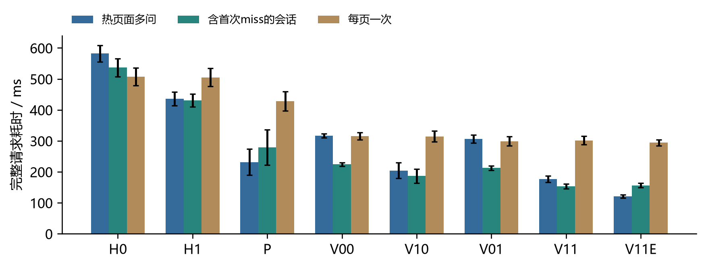

# 推理框架对照：独立评估结果

完成24次独立启动（21次主对照、3次encoder容量辅助），三个种子、三个访问场景，共72个区组、9720条计时请求。评估集为新选出的64页269问，源文档和RGB图片均与旧开发/评估集合互斥，保留所选页面的全部真实问题。

## 实验范围与配置

复用infer-lab已有vLLM 0.32.0 Docker镜像，固定image ID为`sha256:befccf0e7e4089aa23926bb6f887a85c0d46c2a99e6de5c5ffdf5cb7957c5b34`，不重新下载镜像或模型。容器Torch 2.13.0+cu130、Transformers 5.19.0；HF/本项目使用既有Torch 2.14.0+cu130、Transformers 5.17.0。比较的是各自软件栈的完整请求路径，框架内部消融使用同一容器环境。

H0为HF原生，H1为HF加视觉缓存，P为本项目完整组合；V00/V10/V01/V11分别为APC/图的关关、开关、关开、开开。vLLM固定编译mode=3、FLASH_ATTN后端、图模式FULL_DECODE_ONLY或NONE、max_num_seqs=1、max_model_len=1024、生成上限64、greedy和真实EOS。CPU processor缓存0.125GiB，KV池1648MiB；本实验max_num_batched_tokens=1024时派生的encoder缓存为1024 token，非所有vLLM配置的通用默认值；V11E仅将encoder缓存扩为16384 token，单步encoder计算预算仍1024。它是额外容量控制，框架源码未改。

全GPU BF16、BF16 KV、相同固定revision和原始RGB图片，不使用量化或推测解码；展开后的全部prompt token IDs已逐请求核对一致。框架将图像归一化移至GPU，原生路径在CPU处理，视觉入口中间表示因此不同；答案质量单独检查，不能声称所有中间张量逐位相同。

时间从驻留CPU图片和提示就绪开始，到首个CPU可见token/最终答案结束，包含各自预处理、传输和执行。原图文件读取、图片驻留准备、模型加载和建图单独处理，主计时不含HTTP。不同于前一轮从GPU输入就绪开始的开发计时，两轮数字不直接混作同一加速比。

## 真实请求结果

下表为三个独立进程种子的均值±样本标准差。热集合有72问，含miss会话覆盖全部269问，每页一次为64问；每个场景内所有实现的问题成员与顺序一致。

场景之间的问题成员和输出长度不同，复用效果由同一场景内的配对配置和encoder调用数判断；不将热、冷两个均值的差直接当作缓存收益。实际输出token总数、按总decode步数加权的ms/token和配置间逐条token身份均保存在CSV中。

| 实现 | 热TTFT/ms | 热完整/ms | 会话完整/ms | 每页一次/ms | 评估ANLS |
| --- | --- | --- | --- | --- | --- |
| H0 | 314.0 ± 12.9 | 582.1 ± 26.5 | 536.7 ± 29.1 | 507.4 ± 28.1 | 0.916489 |
| H1 | 169.0 ± 7.7 | 436.0 ± 21.9 | 431.0 ± 20.9 | 504.9 ± 29.2 | 0.916489 |
| P | 121.6 ± 38.4 | 231.6 ± 41.6 | 278.4 ± 57.0 | 427.8 ± 31.3 | 0.916489 |
| V00 | 208.6 ± 4.2 | 316.8 ± 6.6 | 224.0 ± 5.6 | 315.2 ± 12.1 | 0.919587 |
| V10 | 89.7 ± 9.2 | 204.1 ± 25.5 | 186.3 ± 23.1 | 314.5 ± 17.6 | 0.919587 |
| V01 | 216.8 ± 9.9 | 306.4 ± 13.3 | 212.6 ± 7.3 | 298.7 ± 14.8 | 0.919587 |
| V11 | 86.3 ± 6.0 | 176.7 ± 10.7 | 153.4 ± 7.5 | 301.4 ± 13.6 | 0.919587 |
| V11E | 30.3 ± 1.3 | 120.9 ± 5.6 | 156.2 ± 7.0 | 294.0 ± 9.2 | 0.919587 |



## 结果分析

在统一CPU输入就绪边界下，完整组合P相对已有视觉缓存H1的热请求耗时比为1.88，从436.0降至231.6 ms，减少46.9%。包含首次miss的会话中，两者为431.0与278.4 ms。它们与旧开发集GPU阶段计时分别统计。

框架内部，V00到V10的热TTFT从208.6变为89.7 ms；V00到V01的热decode从17.46变为14.46 ms/token。APC与图模式分别关联输入状态复用和后续执行成本，组合收益以V11的实际完整请求为准，不把两项百分比相加。

V11与扩容辅助V11E的热请求分别为176.7和120.9 ms，encoder执行从36.7变为0.0次；这两个配置在热集合的输出token有216/216条逐序列一致。容量对照将视觉结果驻留与APC/图模式区分开，避免用一个encoder容量较小的框架配置代表全部框架能力。

访问局部性也能从调用数观察：V00在随机交错的热集合上平均编码70.0次/72问，在按页连续的完整会话中编码64.0次/269问。热集合已预热不等于所有页面状态仍驻留；问题输出长度也不同，所以场景名字不能代替实际命中与计算量记录。

热请求中P与V11E分别为231.6和120.9 ms，均值较低者为V11E；含miss会话分别为278.4和156.2 ms，每页一次分别为427.8和294.0 ms。这里比较的是本机指定负载和各自软件栈，解释时同时使用缓存计数、实际显存与输出长度。

P的热请求输入准备平均为56.2 ms，已经计入完整延迟。本原型没有跨请求CPU processor缓存，框架配置了0.125GiB缓存并使用GPU图像归一化，因此P与vLLM的差异还包含输入处理路径；不能全部归于语言层或CUDA图。框架V00的解码成本也保留在表中，展示其在APC/图开关之外已有的执行能力。

三轮P热请求的输入准备为47.6—71.1 ms，decode为17.37—18.27 ms/token。较慢区组的额外时间主要出现在输入准备和首token之前，全部原始区组均保留，未删除或替换。GPU温度/功耗采样用于描述运行背景，现有记录不足以把波动单独归因于热降频或某个主机进程。


## 机制和内存证据

| 实现 | 热encoder执行 | 热前缀命中请求 | 热命中token | 热decode/ms每token | 峰值allocated/GiB |
| --- | --- | --- | --- | --- | --- |
| H0 | 72 | 0/72 | 0 | 43.23 | 4.249 |
| H1 | 0 | 0/72 | 0 | 43.06 | 4.970 |
| P | 0 | 72/72 | 53900 | 17.69 | 5.743 |
| V00 | 70 | 0/72 | 0 | 17.46 | 5.775 |
| V10 | 37 | 72/72 | 53520 | 18.48 | 5.775 |
| V01 | 70 | 0/72 | 0 | 14.46 | 5.783 |
| V11 | 37 | 72/72 | 53520 | 14.60 | 5.783 |
| V11E | 0 | 72/72 | 53520 | 14.62 | 6.028 |

持久视觉负载、前缀KV和框架KV池不是同一种内存表示。本项目1536MiB为持久负载，另有112MiB工作KV；框架1648MiB KV池同时供活跃状态和前缀使用，另有encoder缓存与图池。V11E增加了encoder驻留容量，各实现运行在同一8188MiB设备上，并记录实际allocated、reserved和每2秒驱动采样；不称为所有缓存表示逐字节等容量。

初始化时间、热场景16页的预热请求费用和驱动采样峰值另见`results/analysis/startup-resources.csv`。初始化不包括随后首次请求可能触发的懒编译；驱动数据为2秒采样，不能当作无遗漏的瞬时峰值。HF适配器沿用已有运行时，H0/H1也保留一个未用于生成的112MiB静态工作区，内存结果包含这部分测量框架成本。

Python重放探针只覆盖动态方法分发，可能漏掉初始化时已保存的绑定方法，也可能计入框架提前执行后丢弃的步骤，因此不用于声称全部CUDA发射次数。诊断在首个CPU可见token后启动CUDA profiler，固定检查其后八个输出间隔。框架调度可能提前执行下一步，这个CPU观察窗口不保证恰好覆盖八次GPU模型调用，不能将观测到的7次图发射直接解释为八步中有一步回退。原始trace及独立重数结果如下；这些诊断时间不纳入主表。

```json
{
  "V00": {
    "runtime_calls": {
      "cudaLaunchKernel": 1456
    },
    "token_ids": [
      18,
      12,
      21,
      12,
      15,
      16,
      151645,
      198,
      151643
    ],
    "scope": "Eight CPU-visible output intervals after the first token; framework scheduling can run ahead. Not exactly eight GPU launches."
  },
  "V01": {
    "runtime_calls": {
      "cudaLaunchKernel": 84,
      "cudaGraphLaunch": 7
    },
    "token_ids": [
      18,
      12,
      21,
      12,
      15,
      16,
      151645,
      198,
      151643
    ],
    "scope": "Eight CPU-visible output intervals after the first token; framework scheduling can run ahead. Not exactly eight GPU launches."
  }
}
```

## 验证与统计

评估质量门槛沿用相对共同H0的ANLS下降不超过0.005，全部配置通过状态为`True`；逐种子结果见`results/analysis/analysis.json`，原始答案和token全部保留。开发选择只使用原282问，配置、实现哈希、问题集合与重复顺序在新评估输出产生前写入`protocol.lock.json`。

审计逐条重算ANLS/EM、时间汇总、请求集合、输入ID身份、源码快照和CUDA trace计数。配对t95区间基于三个独立种子、df=2，分别保存在`paired.csv`，不能把单次请求当作独立设备重复来缩小误差。

三个场景之间显式清空prefix、processor和encoder缓存并保留预热记录；冷复用对照表示页面缓存未命中，不是每条请求都重新加载权重。图模式对整体执行的影响由实际trace观察，不能仅凭枚举名称把全部变化归因于某个kernel。

## 原始数据与复现

代码、冻结协议、开发门槛、每次独立启动的源码快照、所有warmup和逐请求JSONL、GPU遥测、启动日志及两份CUDA trace均位于本目录。逐区组/均值/配对CSV位于`results/analysis/`。一键与逐步命令见`README.md`，已有结果不会覆盖。

AI用于适配器、分析脚本和文档辅助，答案与性能记录均由固定本地模型在真实GPU上产生。状态隔离的运行时不变量检查沿用第二轮验证；本次框架扩展不新增形式化证明。
