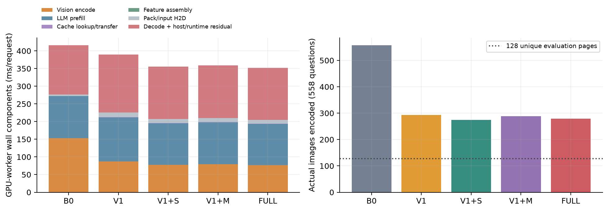
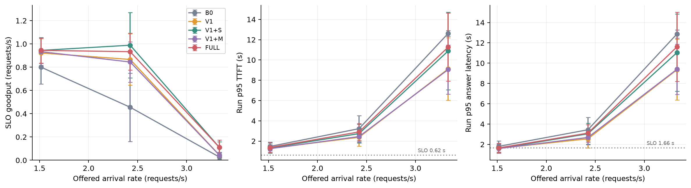
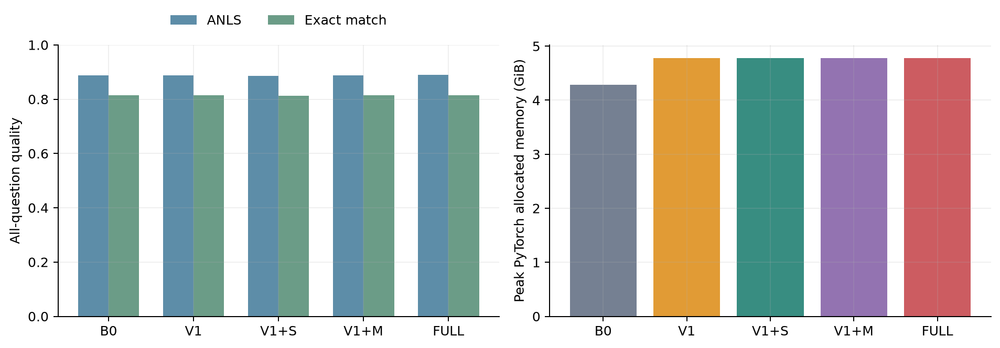
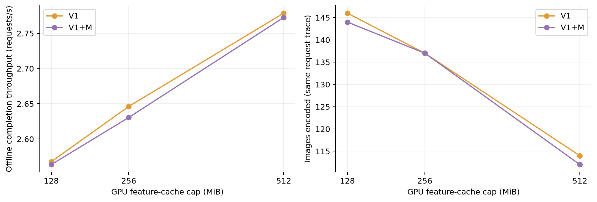

# 面向小显存 GPU 的文档视觉问答推理优化

## 视觉特征复用、图像亲和调度与 GPU/CPU 缓存管理

系统优化课程第二项目 · 实验日期 2026-11-16 · 独立完成，使用 AI 辅助编码与分析

## 摘要

文档视觉问答中，同一页面的多个独立问题会反复触发视觉编码，但不同问题的语言上下文仍需独立计算。本项目在 WSL2 的 RTX 4060 Laptop 8GB GPU 上，实现 Qwen3-VL-2B-Instruct 的完整视觉特征缓存、有限窗口图像亲和调度，以及考虑重编码代价和复访频率的 GPU/CPU 缓存管理。使用真实 DocVQA validation 自划分数据：开发集 64 页 282 问，评估集 128 页 558 问，源文档互斥。固定 BF16、SDPA、768 视觉 token 上限和短答案 prompt，完成五变体、三负载、三种子的 45 轮开放环实验。

在 0.8 倍开发容量的中负载下，FULL 的平均 SLO goodput 为 0.933 请求/s，B0 为 0.456 请求/s，比例为 2.05；平均每轮 TTFT p95 变化为 -10.0%。全量评估中，FULL 的 ANLS 为 0.88936，B0 为 0.88877，差值 +0.00059，通过预登记的 −0.005 门槛。O1 在三档负载中有 3 档平均 goodput 为正，2 档的三种子配对 95% t 区间完全大于零。O2 在三档负载中有 3 档平均 goodput 为正，0 档的三种子配对 95% t 区间完全大于零。O3 在三档负载中有 1 档平均 goodput 为正，0 档的三种子配对 95% t 区间完全大于零。所有请求、阶段耗时、答案、缓存计数与显存原始记录均保留，可脱离 GPU 重新核验表格。

## 1. 研究意义与问题

本地文档助手常对同一页扫描件提出多个不同问题。Qwen3-VL 的视觉编码器读取图像，产生主视觉 embedding 和三组 DeepStack 特征；随后这些特征进入语言模型，执行问题相关的 prefill 和自回归生成。直接重复运行整条推理路径，会在图像内容未变时重复视觉计算。架构依据 [Qwen3-VL 文档](https://huggingface.co/docs/transformers/model_doc/qwen3_vl)，具体边界由本地固定版本源码和真实 GPU 对照确定。

研究问题是：在模型、像素、精度和问题完全相同的条件下，视觉编码复用能带来多大延迟收益；当多个文档会话交错、缓存容量受限时，服务调度和存储管理能否进一步把复用转化为 SLO goodput。缓存针对完整视觉特征，不复用不同问题的语言 KV，不缓存最终答案。128 页评估工作集的潜在唯一页面复用上限为 1−128/558=77.1%，实际收益还取决于容量、次序和到达强度。

## 2. 环境、数据与可复现控制

| 项目 | 固定配置 |
| --- | --- |
| 平台 | WSL2 / Ubuntu 24.04.5 LTS，Linux 6.6.87.2 |
| CPU / 内存 | Ryzen 7 7735H，WSL 可见 8 逻辑 CPU，约 7.76 GiB 内存 |
| GPU | NVIDIA RTX 4060 Laptop，8188 MiB，驱动 592.00 |
| 运行库 | Python 3.12.3，PyTorch 2.14.0+cu130，Transformers 5.17.0，Z3 5.4.1 |
| 模型 | Qwen/Qwen3-VL-2B-Instruct，revision `89644892e4d85e24eaac8bacfd4f463576704203` |
| 精度 / 后端 | 全 GPU BF16 / SDPA；greedy；max_new_tokens=64；普通请求内 KV |
| 输入 | 每页最多 768 视觉 token，左侧 padding，统一 chat template 和短答案后缀 |
| 公共执行 | 视觉逐页 microbatch=1，语言最多 2 请求/批，2 ms 等待，2 CPU 线程，队列上限 32 |
| 缓存 | GPU 上限 512 MiB，CPU 上限 256 MiB；相同按批 KV/workspace 保护 |
| 观测 | 每轮 60 s 到达窗口，最多 30 s drain；独立模型进程；缓存冷启动 |

原始数据来自 `lmms-lab-encoder/DocVQA`，revision `539088ef8a8ada01ac8e2e6d4e372586748a265e`，六个 validation Parquet 共 5,349 个真实问题。按源文档 ID 的固定 SHA256 顺序选开发/评估页面，保留选中页面的全部真实问题。开发与评估分别来自 47 和 81 个源文档，文档 ID 与完全相同 RGB 像素的交集均为零。只检查精确像素重复，未宣称完成近重复图像检索。这是公开 validation 上的自划分实验，数值不等同官方隐藏 test 成绩。

主负载按固定种子全局随机排列真实问题，使用指数间隔生成泊松到达，属于合成回放时间；每轮所有变体读取相同 trace。连续同页、16 页会话交错和每页只问一次作为辅助控制。没有通过改写问题、答案缓存或改变分辨率制造复用。

模型权重 SHA256、数据分片 SHA256、原始图片 SHA256/RGB SHA256、运行代码 SHA256 和软件清单分别保存在 `configs/`、`data/processed/docvqa/manifest.json`、`env/`。共享现有推理虚拟环境，未新建 CUDA 工具链、未升级基础环境包。

## 3. 测量驱动的优化设计

### 3.1 基线瓶颈与 Amdahl 分析

在全量评估的 B0 离线运行中，视觉编码约占 GPU worker service wall time 的 36.7%。保持其他阶段不变、完全消除视觉编码时，服务时间的理想上限约为 1.58 倍。这个上限用于解释 O1 的阶段收益；排队系统中的 p95 与 goodput 还受负载和调度影响，不能直接套用同一个倍数。

下图按请求分摊批次 service time。视觉编码和 prefill 使用 CUDA Events；输入组批、缓存查找/搬运与拼接使用单调时钟；剩余部分明确称为“decode 与主机/运行时余项”，包含 token 回传、解码和调用开销，并非纯 GPU decode kernel 时间。CPU 图像处理可与 GPU worker 重叠，单独保留在请求日志中，不与 GPU service 简单相加。



### 3.2 O1：推理计算图层的完整视觉特征复用

在 `get_image_features` 边界缓存主 embedding 与三层 DeepStack，共四个 BF16 `[V,2048]` 张量，每页 payload 为 `V×2048×2×4` 字节。每页从批张量切片后独立 clone，避免缓存一页却保留整批底层 storage。身份由冻结页面 RGB 像素哈希、实际 grid、processor、模型 revision、dtype、backend、视觉执行粒度和 Transformers 版本组成；评估文件在复核时逐一检查原始字节和像素哈希。

所有变体统一逐页调用原生视觉编码器，语言模型仍保留 batch=2。这样每个页面的 BF16 视觉计算形状固定，不受同批其他图像的数量与尺寸影响，O1 在相同语言批次下可以严格复用相同张量。此项是所有对照共有的数值稳定执行规则，未归入某个优化的独立加速。

缓存单位的空间成本直接对应 AI 推理结构。本模型完整视觉特征每个视觉 token 为 `4×2048×2=16 KiB`；BF16 语言 KV 每个 token 为 `2×28层×8个KV头×128维×2=112 KiB`，字节比为 7。以真实常见的 744 视觉 token 页面为例，完整视觉特征为 11.625 MiB，对应视觉段的 BF16 KV 字节预算为 81.375 MiB。该字节模型来自固定模型配置，未计 allocator 与额外文本；它解释了长期保存视觉编码结果的空间收益，也解释了本方案仍需执行语言 prefill。原始配置和公式输出保存在 `env/qwen3-vl-2b-config.json` 与 `env/feature-memory-model.json`，这项分析不作为未实现的 prefix-KV 方法的速度比较。

同批次相同页面只编码一次，按原请求次序装配视觉特征。单 GPU worker 保证生产者唯一；当前批次全部使用 lease 固定，计算结束后统一释放。不同问题的 input IDs、attention mask、位置编码、prefill 与生成始终正常执行，缓存中没有问题答案或语言 KV。

### 3.3 O2：服务运行时层的有界图像亲和调度

只查看已完成 CPU 预处理的前 16 个等待请求。优先保障等待达到 TTFT SLO 一半的最老请求；其他情况下按文本 prefill 代价、GPU/CPU/miss 视觉代价选首请求，再优先配对同图或长度接近的第二请求。每批最多两个请求，总视觉 token 不超过 1,536。代价系数由开发集实际阶段时间校准，调度器无法读取未来 trace。

### 3.4 O3：GPU/CPU 存储层的收益/字节管理

在相同 GPU/CPU payload 上限下，以 `(1+衰减复访频率)×估计视觉重编码时间/特征字节数` 估计保留价值。编码成本由当前 miss 批次的实测编码时间按各页视觉 token 占比分配。频率以 64 次请求为半衰期；GPU 淘汰可降到 CPU，CPU 命中同步回搬完整特征。LRU 对照与 O3 共用同样的两级存储、搬运机制、lease 和按批预算保护，O3 改变受限空间中的准入及淘汰对象。

按批预算由参数字节、估算 KV 与 256 MiB workspace reserve 推导，并对所有缓存变体生效。估算属于缓存保护规则，不能等同于整进程显存硬隔离。主运行若未触发该保护，性能差异归因于缓存保留策略；预算敏感性通过相同 trace 和显式容量上限验证。8GB 是真实设备容量，128/256/512 MiB 是受控缓存资源预算，不把人为缓存上限描述为整张 GPU 的物理剩余空间。

本次主矩阵有 0 个批次因该预算保护缩小 GPU 缓存上限，O3 的独立效果按实际发生的准入/淘汰行为解释。

## 4. 实验方法与开发集冻结

| 变体 | 完整视觉缓存 | 调度 | 缓存策略 |
| --- | --- | --- | --- |
| B0 | 关闭 | FIFO | 统一逐页原生视觉模块 |
| V1 | 开启 | FIFO | 两级 LRU |
| V1+S | 开启 | O2 | 与 V1 相同 LRU |
| V1+M | 开启 | FIFO | O3 收益/字节 |
| FULL | 开启 | O2 | O3 收益/字节 |

所有变体使用相同输入、prompt、BF16/SDPA、生成参数、CPU 预处理、最大语言批次、逐页视觉执行、队列和时钟。B0 每次正常调用 Transformers 原生视觉模块；缓存变体仍为每个完成请求执行生成。

### 4.1 质量约束驱动的视觉执行修正

初版直接使用原生 packed 视觉批次。完整视觉特征虽然未经压缩，但同图去重或命中后跳过部分图像会改变 BF16 GEMM 的计算形状。首轮全量质量检查中，V1+S 的 ANLS 差为 −0.00585，未通过已经登记的 −0.005 门槛。该轮原生 packed B0 的离线吞吐为 2.439 请求/s，所有五个变体的原始答案、代码、协议和失败 gate 均保留在 `results/initial-packed-vision/`。

| 初版变体 | 全量 ANLS | 相对初版原生 B0 | 固定门槛判断 |
| --- | --- | --- | --- |
| B0 | 0.89126 | +0.00000 | 通过 |
| V1 | 0.88820 | -0.00306 | 通过 |
| V1+S | 0.88541 | -0.00585 | 未通过 |
| V1+M | 0.88820 | -0.00306 | 通过 |
| FULL | 0.88814 | -0.00311 | 通过 |

修正对所有变体统一采用视觉 microbatch=1，保留语言 batch=2、原始图片、BF16、SDPA 和原质量门槛，然后重新在开发集校准并冻结协议，再开展本报告的正式性能矩阵。新的 GPU 诊断要求单图、同图双问和异图双请求的完整特征与首步 logits 均严格一致。评估问题曾用于这次正确性纠错，因此最终质量是修正后的重复验证，未将其描述为首次盲测。正式性能 trace 在修正后锁定，初版没有执行性能主矩阵。

### 4.2 开发集参数与正式测量

开发集对 batch=1/2 和 LRU 的 128/256/512 MiB 缓存做容量测量。公共 batch 选择原生基线吞吐较高者，GPU 缓存选择吞吐距最优 1% 内的最小容量，不根据 O3 的收益选取。候选使用同一 192 请求开发 trace，性能选择不读取评估答案。

| 开发集候选 | batch | GPU 缓存 / MiB | 离线吞吐 / 请求/s | ANLS |
| --- | --- | --- | --- | --- |
| development/native-b1 | 1 | 0 | 2.161 | 0.88073 |
| development/native-b2 | 2 | 0 | 2.412 | 0.88593 |
| development/lru-128 | 2 | 128 | 2.820 | 0.88593 |
| development/lru-256 | 2 | 256 | 2.951 | 0.88593 |
| development/lru-512 | 2 | 512 | 3.030 | 0.88593 |

选定 LRU 容量为 512 MiB，开发参考容量为 3.030 请求/s。32 个无排队原生开发请求的 TTFT p95 为 0.306 s，完整回答 p95 为 0.827 s；按两倍并向上取整到 10 ms 固定 SLO 为 0.62 s / 1.66 s。主到达率固定为参考容量的 50%/80%/110%，配置在正式评估前写入 `protocol.lock.json`。

主矩阵包含 5×3×3=45 个单元，种子 1701/1702/1703。每个单元独立启动模型，使用开发数据预热至少 8 请求且不少于 5 秒，随后清空视觉缓存和峰值计数；评估特征不参与预热。区组和区组内算法顺序固定随机化，以分散温度及频率漂移。

### 指标与计时

- 首 token：生成 streamer 收到首个真实生成 token 的 CPU 可见时刻，跳过 prompt 回调。完整回答：EOS 或上限后完成文本解码时刻。两者均从计划到达时刻计时，包含发送延迟、预处理和排队。
- Goodput：到达窗口内请求中，同时满足 TTFT 和完整回答 SLO 的完成请求数 / 固定 60 s。允许 drain 后按原到达时刻核算；队列拒绝和超时均不计成功，达标率分母含全部到达请求。
- 质量：全体 558 个问题独立执行，不用过载时完成子集替代全量质量。ANLS 使用归一化 Levenshtein 距离阈值 0.5，取参考答案最大值；统一 NFKC、casefold 和空白合并。这是明确给定规范化的本地 ANLS 口径。EM 使用同样规范化。保留原始答案与 token IDs。
- 统计：表中为三次独立运行的均值与样本 SD，p95 先在每轮计算再平均；消融使用相同种子的配对差及 n=3 的 95% t 区间。质量差区间按 81 个源文档进行 2,000 次配对 cluster bootstrap。样本规模支持趋势和区间展示，未将逐请求样本当作独立重复，也未对稳定 p99 作结论。

## 5. 实验结果

### 5.1 开放环延迟与 goodput

| 负载 / 到达率 | 变体 | goodput 请求/s（均值±SD） | TTFT p95 / s | 回答 p95 / s | SLO 达标率 | 拒绝数 / 轮 |
| --- | --- | --- | --- | --- | --- | --- |
| 0.5 / 1.515 | B0 | 0.800±0.145 | 1.476 | 1.808 | 56.1% | 0.0 |
| 0.5 / 1.515 | V1 | 0.922±0.123 | 1.277 | 1.612 | 64.6% | 0.0 |
| 0.5 / 1.515 | V1+S | 0.944±0.111 | 1.320 | 1.588 | 66.2% | 0.0 |
| 0.5 / 1.515 | V1+M | 0.933±0.117 | 1.253 | 1.589 | 65.4% | 0.0 |
| 0.5 / 1.515 | FULL | 0.944±0.108 | 1.368 | 1.655 | 66.1% | 0.0 |
| 0.8 / 2.424 | B0 | 0.456±0.294 | 3.230 | 3.440 | 19.8% | 0.0 |
| 0.8 / 2.424 | V1 | 0.867±0.220 | 2.382 | 2.552 | 37.6% | 0.0 |
| 0.8 / 2.424 | V1+S | 0.989±0.281 | 2.742 | 3.045 | 42.9% | 0.0 |
| 0.8 / 2.424 | V1+M | 0.844±0.173 | 2.450 | 2.681 | 36.6% | 0.0 |
| 0.8 / 2.424 | FULL | 0.933±0.159 | 2.907 | 3.110 | 40.5% | 0.0 |
| 1.1 / 3.333 | B0 | 0.028±0.019 | 12.621 | 12.880 | 0.9% | 22.0 |
| 1.1 / 3.333 | V1 | 0.044±0.025 | 9.118 | 9.358 | 1.4% | 8.3 |
| 1.1 / 3.333 | V1+S | 0.111±0.048 | 10.891 | 11.048 | 3.5% | 4.3 |
| 1.1 / 3.333 | V1+M | 0.044±0.025 | 9.057 | 9.400 | 1.4% | 6.7 |
| 1.1 / 3.333 | FULL | 0.111±0.063 | 11.270 | 11.614 | 3.5% | 4.7 |



每个负载都保留了 B0、O1 强基线及两个独立消融，能够将省去视觉计算的收益和后续运行时/缓存收益分开判断。摘要选用 0.8 档中负载，三档完整结果均在表中。高负载下分位数只覆盖完成请求，因此须与拒绝数、达标率和固定窗口 goodput 联合阅读；当成功请求数很少时，比例提升须结合绝对请求数及配对区间判断。全部 45 轮完成了请求记账，原始发送时刻和监控数据可追溯。

### 5.2 三项优化的独立作用

| 负载 | 独立作用 | 比较 | goodput 差 / 请求/s | 配对 95% t 区间 |
| --- | --- | --- | --- | --- |
| 0.5 | O1 | V1 vs B0 | +0.122 | [+0.003, +0.242] |
| 0.5 | O2 | V1+S vs V1 | +0.022 | [-0.026, +0.070] |
| 0.5 | O3 | V1+M vs V1 | +0.011 | [-0.093, +0.115] |
| 0.5 | S+M | FULL vs V1 | +0.022 | [-0.064, +0.108] |
| 0.5 | all | FULL vs B0 | +0.144 | [-0.060, +0.349] |
| 0.8 | O1 | V1 vs B0 | +0.411 | [+0.076, +0.746] |
| 0.8 | O2 | V1+S vs V1 | +0.122 | [-0.120, +0.365] |
| 0.8 | O3 | V1+M vs V1 | -0.022 | [-0.261, +0.217] |
| 0.8 | S+M | FULL vs V1 | +0.067 | [-0.099, +0.232] |
| 0.8 | all | FULL vs B0 | +0.478 | [+0.022, +0.934] |
| 1.1 | O1 | V1 vs B0 | +0.017 | [-0.055, +0.088] |
| 1.1 | O2 | V1+S vs V1 | +0.067 | [-0.058, +0.191] |
| 1.1 | O3 | V1+M vs V1 | +0.000 | [+0.000, +0.000] |
| 1.1 | S+M | FULL vs V1 | +0.067 | [-0.083, +0.216] |
| 1.1 | all | FULL vs B0 | +0.083 | [-0.026, +0.193] |

O1 在三档负载中有 3 档平均 goodput 为正，2 档的三种子配对 95% t 区间完全大于零。O2 在三档负载中有 3 档平均 goodput 为正，0 档的三种子配对 95% t 区间完全大于零。O3 在三档负载中有 1 档平均 goodput 为正，0 档的三种子配对 95% t 区间完全大于零。配对区间跨零的结果作为趋势，不声称稳定统计提升。O2 的价值取决于待处理队列中能否找到更合适的图像/长度组合；O3 的价值取决于工作集与缓存预算，以及历史复访对未来请求的预测程度。两者没有改变解码算法，单纯视觉复用也不会消除语言模型 prefill 和短答案生成。

本机中负载的最大平均 goodput 来自 V1+S，为 0.989 请求/s；V1+S/FULL 分别为 0.989/0.933。V1+M 相对 V1 的平均差为 -0.022 请求/s，配对区间包含零，未观察到稳定的正收益。以中负载平均 goodput 为工程选择依据，优先配置 O1+O2 与 LRU；FULL 是预登记的组合对照，其名称不代表所有条件下都最好。

调度也存在目标取舍：中负载 V1 的平均 TTFT p95 为 2.382 s，V1+S 为 2.742 s。更高 SLO goodput 与更低完成请求 p95 并非同一个目标；对尾延迟优先的部署，应结合 FIFO 对照选择。表中保留这项差异，而不只展示有利指标。

### 5.3 全量质量、计算量与显存

| 变体 | 问题数 | ANLS | EM | ANLS 相对 B0 | 完全相同 token 序列 | 视觉编码数 | 离线请求/s | 峰值 allocated / GiB |
| --- | --- | --- | --- | --- | --- | --- | --- | --- |
| B0 | 558 | 0.88877 | 0.81541 | +0.00000 | 558/558 | 558 | 2.400 | 4.286 |
| V1 | 558 | 0.88877 | 0.81541 | +0.00000 | 558/558 | 293 | 2.563 | 4.783 |
| V1+S | 558 | 0.88685 | 0.81362 | -0.00192 | 555/558 | 274 | 2.806 | 4.781 |
| V1+M | 558 | 0.88877 | 0.81541 | +0.00000 | 558/558 | 288 | 2.783 | 4.781 |
| FULL | 558 | 0.88936 | 0.81541 | +0.00059 | 554/558 | 279 | 2.837 | 4.783 |

同一 558 请求离线工作负载下，FULL 的实际视觉编码数从 B0 的 558 降为 279，减少 50.0%；完成吞吐从 2.400 增至 2.837 请求/s，为 1.18 倍。这组单次全量运行用于分析计算量和服务阶段，负载下的主性能证据采用三种子开放环结果。



FULL 相对 B0 的 ANLS 差为 +0.00059，按源文档 bootstrap 的 95% 描述区间为 [-0.00022, +0.00224]。质量门槛按预登记的实测点估计判断，不把门槛通过等同于 token 逐位一致或质量非劣性的正式统计证明。输出 token 总数、截断数和与 B0 完全相同的 token 序列数均在 `tables/quality.csv`。

### 5.4 缓存预算、请求次序与冷复用控制

| 实验 | 变体 | 请求数 | 离线吞吐 / 请求/s | 视觉编码数 | CPU 命中 | H2D / MiB | ANLS（此 trace） |
| --- | --- | --- | --- | --- | --- | --- | --- |
| budget-128 | V1 | 192 | 2.568 | 146 | 24 | 278.0 | 0.87754 |
| budget-128 | V1+M | 192 | 2.564 | 144 | 29 | 336.3 | 0.87754 |
| budget-256 | V1 | 192 | 2.646 | 137 | 19 | 219.8 | 0.87754 |
| budget-256 | V1+M | 192 | 2.631 | 137 | 19 | 219.8 | 0.87754 |
| budget-512 | V1 | 192 | 2.779 | 114 | 23 | 261.8 | 0.87754 |
| budget-512 | V1+M | 192 | 2.773 | 112 | 24 | 277.6 | 0.87754 |
| cold | B0 | 128 | 2.355 | 128 | 0 | 0.0 | 0.96040 |
| cold | FULL | 128 | 2.291 | 128 | 0 | 0.0 | 0.96076 |
| cold | V1 | 128 | 2.335 | 128 | 0 | 0.0 | 0.96040 |
| order-interleaved | B0 | 192 | 2.348 | 192 | 0 | 0.0 | 0.87233 |
| order-interleaved | FULL | 192 | 2.876 | 99 | 0 | 0.0 | 0.87233 |
| order-interleaved | V1 | 192 | 2.807 | 99 | 0 | 0.0 | 0.87233 |
| order-random | B0 | 192 | 2.430 | 192 | 0 | 0.0 | 0.87754 |
| order-random | FULL | 192 | 2.792 | 110 | 14 | 157.7 | 0.87754 |
| order-random | V1 | 192 | 2.754 | 114 | 23 | 261.8 | 0.87754 |
| order-session | B0 | 192 | 2.417 | 192 | 0 | 0.0 | 0.87754 |
| order-session | FULL | 192 | 2.847 | 99 | 0 | 0.0 | 0.87754 |
| order-session | V1 | 192 | 2.857 | 99 | 0 | 0.0 | 0.87754 |



预算实验保持 CPU 上限、问题顺序和所有模型设置不变，比较 LRU 与 O3 在相同 GPU payload 上限的结果。次序实验和冷页面实验是单次机制诊断，不赋予三种子主矩阵同等统计权重。每页一次的冷对照没有可复用页面，其中 B0/V1 保持相同 FIFO，用于量出纯缓存和元数据管理开销；FULL 同时包含请求组批调度的作用。热页面结果的适用范围由这些控制共同界定。

LRU 的 GPU 缓存从 128 增到 512 MiB 时，192 个相同问题的离线吞吐由 2.568 变为 2.779 请求/s（+8.2%），视觉编码数由 146 变为 114，PyTorch 峰值 allocated 变化 +379.0 MiB。这量出了空间换计算的实际代价，而不仅是命中率变化。价值替换在三个预算上的吞吐差绝对值最大为 0.59%，结合主矩阵的配对结果判断其管理收益。

同一组 192 问包含 99 个唯一页面；按页面连续、16 页交错、随机次序时，LRU 分别编码 99/99/114 次。真实问题的页面局部性决定缓存能否接近唯一页面下界。在 128 个冷页面上，B0/V1 分别为 2.355/2.335 请求/s，缓存吞吐变化为 -0.83%，且都恰好编码 128 张图像。单次图像场景没有可复用视觉计算，速度差反映管理开销与运行波动。

## 6. 正确性、形式化验证与结果复核

真实 GPU 诊断覆盖单页、同页不同问题、不同页面批次和 CPU 回搬。采用统一逐页视觉执行后，四个诊断组合在原生、miss、GPU hit、CPU hit 路径的完整特征与 token 序列均一致，首步 logits 最大绝对差均为零；GPU→CPU→GPU 搬运逐位相同。修正前同页双请求去重曾产生首步 logits 最大绝对差 0.375，原生单图/双图视觉编码也出现特征差异。初始严格失败记录在 `results/diagnostics-initial-batch-check/`，初版全量失败在 `results/initial-packed-vision/`，最终严格诊断在 `results/diagnostics/equivalence.json`。语言调度仍可能改变文本批次的 BF16 舍入，其质量继续受全量答案门槛约束。

Z3 对 3 个条目、8 步操作、每条目最多 2 个 lease 的有界所有权模型检查“活跃推理不能引用已释放特征”。启用引用保护时为 UNSAT，移除保护的负控制为 SAT 并保存反例；同时穷举真实 LRU/value victim selector 的 54 个 pin 组合。它验证的是有界抽象所有权性质，未宣称证明整个 Python/CUDA 程序或神经网络数值等价。SMT2、版本、操作编码和反例见 `results/verification/`。

独立复核脚本已重新计算全部主实验的质量、SLO、请求账本和 trace 配对，检查 6295 个主请求、3846 个批次与 192 张原始图像。各批 payload 不超过对应 GPU/CPU 上限，批末 lease 为零；计划到达、接收、预处理、调度、首 token 和完成时间顺序一致。Torch profiler 的实际 CPU/CUDA trace 仅用于解释 kernel 与 miss/hit 路径，主实验关闭 profiler。

## 7. 与相关工作的比较

| 工作 | 复用/优化对象 | 部署和资源方式 | 本项目可对比的效果 |
| --- | --- | --- | --- |
| [Transformers Qwen3-VL](https://huggingface.co/docs/transformers/model_doc/qwen3_vl) | 每次正常视觉编码、prefill、decode | 本机 BF16/SDPA，统一逐页视觉模块 | 本机 B0；全部性能差和质量差均有同机实测；原生 packed 初版另有归档 |
| [ElasticMM](https://arxiv.org/abs/2507.10069) | 模态和阶段解耦、弹性并行、多模态 prefix cache | 多模态服务系统和分布式资源调度 | 对照其阶段感知与缓存思想；本项目实测单 GPU 的 O1/O2/O3 消融 |
| [VisMemo](https://arxiv.org/abs/2610.25136) | 视觉 KV 的精确/近似候选复用、选择性重算、分级存储 | 面向更长视觉上下文和大缓存后端 | 本项目只复用相同页面的视觉编码输出，DeepStack 完整保存，问题相关 KV 正常重算 |

与原生路径的量化对照直接见上述五变体表。相关论文的模型、输入长度、硬件和服务架构与本项目不同，未在本机实现 ElasticMM/VisMemo，因此不将论文加速倍数与本机数字并排冒充同条件实测。本项目建立的是消费级 WSL GPU 下完整视觉边界、有限调度窗口和两级缓存的可复现实验证据。

## 8. 结论与适用范围

完整视觉特征复用使文档同页多问成为可利用的推理工作负载，且缓存管理必须覆盖主 embedding、三层 DeepStack、字节预算和在用引用。五变体实验把模型计算图层、服务调度层和 GPU/CPU 存储层的作用分别量出；最终策略的选择应依据相应到达率下的 goodput 与配对区间，并同时满足全量质量门槛。

本机以中负载 SLO goodput 为目标时，优先配置 O1+O2 与 LRU（V1+S）。该选择来自独立消融中观察到的实际取舍，三项机制的源码、预算控制和全部结果均保留。

实测结论覆盖本机 Qwen3-VL-2B、统一图像预算和真实问题的合成回放；它不等同于 HTTP 网络服务吞吐、长视频推理或多 GPU 服务成绩。主窗口为 60 秒、每配置三次，温度/频率按 5 秒采样并按区组随机化，完整监控保留供复查。缓存容量敏感性解释受限资源下的选择，不把缓存上限当作显卡物理容量。下一步可在更长连续服务和更长视觉上下文上检验相同机制。

## 9. 复现与交付索引

在项目根目录执行：

```bash
./stage_2/run.sh verify-results     # 从原始数据重算正确性和 SLO，不重新跑模型
./stage_2/run.sh report             # 生成本报告、CSV 和 PNG/SVG/PDF 图
./stage_2/run.sh test               # CPU 不变量测试及 Z3 验证
./stage_2/run.sh experiments        # 依锁定协议续跑/重跑正式与辅助实验
```

完整环境及从零复现步骤见 `../REPRODUCE.md`；独立新跑目录和保留历史数据的说明也在该文档。推理/缓存/调度源代码位于 `src/vlmbench/`，协议在 `configs/protocol.lock.json`，原始与中间结果在 `results/`，所有报告表来自 `report/tables/`。AI 辅助范围见[AI 使用说明](../docs/AI使用说明.md)。

## 参考文献与来源

1. Mathew et al. [DocVQA: A Dataset for VQA on Document Images](https://arxiv.org/abs/2007.00398)；[官方数据介绍](https://www.docvqa.org/datasets/docvqa)。真实问题与 ANLS 的来源。
2. [Qwen3-VL 模型和架构](https://huggingface.co/docs/transformers/model_doc/qwen3_vl)；[固定模型仓库](https://huggingface.co/Qwen/Qwen3-VL-2B-Instruct/tree/89644892e4d85e24eaac8bacfd4f463576704203)。实际接口以本地 Transformers 5.17.0 为准。
3. [LMMs-Lab DocVQA 镜像](https://huggingface.co/datasets/lmms-lab-encoder/DocVQA/tree/539088ef8a8ada01ac8e2e6d4e372586748a265e)。冻结原始数据与 revision。
4. Liu et al. [ElasticMM: Efficient Multimodal LLMs Serving with Elastic Multimodal Parallelism](https://arxiv.org/abs/2507.10069)。阶段感知服务与多模态缓存比较。
5. Gao et al. [Visual Cache Reuse for Efficient Multimodal Inference](https://arxiv.org/abs/2610.25136)。视觉 KV 复用和分层管理比较。
